<!-- Copyright (c) 2026 Timon Gentzsch. LGPL-2.1-only WITH OCCT-exception-1.0. -->

# OCCT mathematical extensions and corrections

This branch starts at official OCCT `b8f597c6` (30 July 2026), followed by `055a9a8a`
(WebAssembly exception conversion) and `c7f60ffe` (null curve guard). It keeps OCCT's history.
Everything below is new commits on top, under one author. Nothing here has been proposed
upstream yet; it is written so that it can be proposed in pieces.

## What is added

| Part | Where | What it is | Depends on |
| --- | --- | --- | --- |
| 17 corrections | one commit each, see [Corrections](#corrections-derivations-and-independent-application) | Fixes to existing OCCT algorithms: quadratic or unbounded loops, wrong ranges, uninitialised reads, missing cancellation | nothing; 14 build against current `master` (one needs another of the 17) |
| Numerical utilities | `GeomAlgoExt_*` in `TKGeomAlgo` | Interval enclosures, Bernstein products, spline collocation, constrained tensor-spline fit, rim fit, certified knot compaction | existing toolkits only |
| Patch chart and interior survey | `BRepAlgoExt_*` in `TKMesh` | Cotangent-weight chart of a boundary loop, interior fairness survey, trim integration, read-back | utilities |
| Operations | `TKAlgoExt`, nine packages, 45 000 lines | Fillet (rolling-ball) solver, Patch (boundary-first fill), skinning and sweep, offsets and shells, curve and surface editing, Booleans on cells | all of the above |

`TKAlgoExt` is the large part. Its packages:

| Package | Operations | Lines |
| --- | --- | ---: |
| `BRepBlendExt` | Rolling-ball blend solver: ball on two supports, spine marching, section fit, attachment to the body | 11 000 |
| `BRepFilletExt` | Constant, variable, range and station fillets, chamfer, contour and prism support, blend validity checks | 3 400 |
| `BRepPatchExt` | Patch: one face inside a closed loop of edges, with G0/G1/G2 to neighbouring faces and interior guides | 4 600 |
| `BRepSurfaceExt` | Surface alignment, bridging, constraint jets, deformation, face support and rebuild, face separation proofs | 5 800 |
| `BRepCurveExt` | Planar and 3D curve offset, outline, tangent circles, projection, rebuild, refinement, regions, spiral | 4 900 |
| `BRepOffsetExt` | Solid offset, hollow, shell, thicken, push-pull, defeaturing, sewing history | 2 400 |
| `BRepSkinExt` | Gordon and guided skins, framed sweeps, draft | 3 700 |
| `BRepBooleanExt` | Cell-based Booleans with a ladder of fallbacks, checked solids, imprints | 2 900 |
| `BRepToolsExt` | Properties, bounding boxes, dimensions, fairness, hidden-line, failure hints, shared checks and history | 1 800 |

### How the operations reach a host

The operations were written for an application that keeps shapes under 32-bit handles. They
keep that interface so that the code is exactly what that application runs, and the seam is
four functions in `BRepToolsExt_Session.hxx`, which the host defines: `store` registers a
shape, `get` returns the shape behind a handle, `release` drops a temporary, and the type
`OcctKernel` is only ever passed back (it is declared, never defined, in this tree). A host that
keeps shapes in a `std::vector` is twenty lines; `adm/scripts/extensions/operation-benchmark.cxx`
is one. Failures are thrown as `BRepExt::Failure`, which derives from `std::runtime_error` and
carries a stable reason code; cancellation polls `sessionCancelled()`, defined by the host.

Three things are deliberately **not** in this tree because they depend on measurements of a
third-party product, or on routines whose provenance is not settled: the blend section law for
curvature continuity (`BRepBlendExt_Policy.hxx` has a conic-section default, and refuses
curvature-continuous requests until a host supplies a law), two routines of Patch for open
boundaries (declared in `BRepPatchExt_Side.hxx`, defined by the host), and the numeric
conventions of the application's curve-bridge and curve-alignment laws, which stay with it.

### Suggested order for upstream review

Upstream would reasonably take this in pieces: (1) the fourteen corrections that apply to
`master` today, each alone; (2) the interval and Bernstein utilities; (3) the spline and rim
fits with their GTests; (4) `BRepToolsExt` and `BRepCurveExt`, which are self-contained and have
the clearest closed-form checks; (5) `BRepOffsetExt`; (6) the blend and Patch solvers last. The
namespace `BRepExt`, the handle seam and the diagnostic hooks are artefacts of where the code
came from; moving the packages to OCCT's class conventions and `Standard_Failure` is mechanical
but is a behaviour change (OCCT code catches `Standard_Failure`), so it is left for review.

## Exact-section blend fitting

The blend solver's section fit is `BRepBlendExt_Fit` (package `BRepBlendExt`, described under
Operations). An earlier prepared implementation of the same numerical step as a stand-alone API
was removed so that the tree holds one copy of what the application runs.

## Boundary-first patch chart

The chart is the original production source. The interior acceptance survey of Patch is
`BRepPatchExt_Inside`; its ratio-four policy is an unproven heuristic, described under
Operations. The table below is historical component evidence, not a remeasurement.

Package `BRepAlgoExt` uses existing toolkit `TKMesh`, because chart construction
requires its Delaunay mesher; it also uses existing lower topology/geometry tools.
`BRepAlgoExt_PatchFlow` forms cotangent stiffness L, solves the interior equation
L_II u=K_I with zero boundary log scale, and obtains boundary turns from
pi-angleSum-(Lu)_boundary. For directions t_i and original lengths l_i,
minimize sum (delta l_i)^2/l_i subject to sum (l_i+delta l_i)t_i=0.
Lagrange multipliers give delta l_i=-l_i t_i^T G^-1 sum l_j t_j,
G=sum l_i t_i t_i^T, the implemented 2x2 closure. Harmonic x/y extension
then solves the Dirichlet energy equations. This follows Rohan Sawhney and
Keenan Crane (2017), [Boundary First Flattening](https://www.cs.cmu.edu/~kmcrane/Projects/BoundaryFirstFlattening/paper.pdf),
read sections 3–5, especially equations 6, 14 and 20. Their section 4.4 distinguishes
boundary interpolation from harmonic conjugation: this implementation uses
interpolation, so **exact discrete conformality is not guaranteed**.

Assumptions: finite regular surface, connected nondegenerate disc mesh, usable
boundary and nonsingular closure, positive resulting edge lengths and triangle
orientation. Cotangent Dirichlet systems are positive definite with fixed nonempty
boundary under the usual finite-element assumptions; arbitrary inputs can refuse.
The node cap, finite curvature survey and parameter-space lattice do **not** certify
3D deflection or global injectivity. The chord estimate k*l²/8 is local asymptotic,
not a proved global surface error bound. The chart may extrapolate off its mesh.

Retained **unproven choices**: 32000 chart nodes; CG residual target 1e-13 and
4n passes; minimum two edge subdivisions, half-spacing rim margin, and the
sqrt(triangleCount/2) lookup-grid sizing. Triangular-lattice sqrt(3)/2 and
sqrt(3)/4 are derived from equilateral geometry; cotangent 1/2 and triangle 1/2
are derived energy/area factors. The interior survey of `BRepPatchExt_Inside` has its own sample counts and guards
(see its source), also inherited heuristics,
not tolerances inferred from the paper. No value or arithmetic order changed.

A native test checks planar pair distances at three scales. Run
`adm/scripts/extensions/module-benchmark.sh patch-chart FORK_BUILD STOCK_BASE_BUILD`
after building static Release TKMesh in both revisions. A rectangle and quarter
cylinder are the same surfaces/trims at scales 0.1,1,10. Stock provides meshing
and scaled carrier UVs; it has no equivalent boundary-first chart operation here.
That reference does less work and generates different meshes. Geometry/angle checks
are outside the process CPU clock.

| Scale 1 fixture | Stock CPU ms | New CPU ms | Stock/new max cosine error | Stock/new nodes |
| --- | ---: | ---: | --- | --- |
| plane-chart | 0.0760 | 0.2770 | 0 / 5.54e-13 | 4 / 75 |
| cylinder-chart | 0.1005 | 0.4510 | 0.000155 / 0.00222 | 18 / 101 |

Ten successes/zero refusals per row, after one warmup; GCC12.2 -O3, TBB off,
Ryzen 9 7950X3D shared machine. The chart can be slower than meshing/carrier UV alone.
This does not compare equivalent flattening solvers. All scales, extrema,
relative edge distortions and curvature errors are in
[patch-chart-measurements.json](adm/scripts/extensions/patch-chart-measurements.json).

## Constrained tensor-spline fitting and certified compaction

`GeomAlgoExt_PatchFit`, `GeomAlgoExt_PatchRim` and `GeomAlgoExt_PatchCompact`
extend `TKGeomAlgo`; `GeomAlgoExt_Band` is their banded Cholesky engine.
They accept OCCT geometry and ordinary C++ containers. `BRepExt::Failure`,
`fail`, `FailureKind` and stable reason constants live in `GeomAlgoExt_Failure`;
fields, strings and the std::runtime_error base are retained. Substituting
Standard_Failure would change which existing OCCT catch blocks intercept a
refusal, so adapting that exception taxonomy is a later upstreaming task.
The integer diagnostic ranking is inherited categorical policy, not geometry;
its scores 100/90/80/70/60/40/30/10/0 encode the retained priority order.
The hash modulus 2147483647 is the signed 31-bit interface ceiling.

Cancellation remains a direct `sessionCancelled()` call at every original
polling site. A native caller constructs `BRepExt::ProgressScope(range)` from
`GeomAlgoExt_Progress.hxx` around the entry call; its thread-local scoped range
backs the native default hook. Nested calls restore their previous range. The
application defines the same link symbol with its existing host implementation.
`BRepExt_PatchPhase` is a separate direct phase-observer hook (native default:
no-op). No new polling or erased callback is inserted in a hot loop. The native
default hook implementation is compiled only for native builds. It is omitted
from WebAssembly archives: a native definition there would satisfy the linker
before a host import and silently replace cancellation/observation.

For a tensor spline S(u,v)=sum P_ij N_i(u) M_j(v), scalar conditions are
linear forms a_r^T p=b_r in the free pole coordinates. The energy is
integral [alpha (|S_uu|²+2|S_uv|²+|S_vv|²) +
beta (|S_uuu|²+3|S_uuv|²+3|S_uvv|²+|S_vvv|²)] du dv.
The coefficients 1,2,1 and 1,3,3,1 count ordered mixed derivatives, hence
are derived. Substituting the basis gives a positive semidefinite quadratic
p^T H p+2g^T p+c. Weighted rows add A^T W A; eliminating fixed poles adds
their exact contribution to the right hand side. Cholesky solves the resulting
symmetric positive definite system when it is positive definite. Multipliers
correct row residuals using products with A M^-1 A^T. Stopped iterations are
retained exactly; convergence, consistency or global optimality are not promised.
The semidefinite claim assumes nonnegative energy coefficients, row weights and
density, finite regular knot spans and consistent constraint dimensions. Solvability
requires positive definiteness after fixed-pole elimination; these are caller
preconditions, not a proof that arbitrary inputs produce a usable surface.
Gauss quadrature with p+1 points integrates the polynomial basis products on
each knot span exactly, but arbitrary supplied density functions have no such
exactness guarantee. Basis locality/derivative identities follow de Boor (1972),
[On Calculating with B-Splines](https://ftp.cs.wisc.edu/Approx/bsplcalc.pdf),
DOI [10.1016/0021-9045(72)90080-9](https://doi.org/10.1016/0021-9045(72)90080-9),
sections 1–2 (recurrences and differentiation) reopened for this mechanical move.
These algebraic derivations do not certify conditioning.

Rim correction linearizes the nearest-point displacement along a supplied unit
vector and solves min_x ||A x-r||²+d²||x||². Its normal equations are
(A^T A+d²I)x=A^T r; unobserved poles stay fixed. The nonlinear projection,
refinement decisions, summation order and refusal messages are preserved.
Compaction proposes OCCT knot removals, converts original and candidate to a
common piecewise Bernstein basis with outward intervals, and bounds displacement
by max_i ||Delta P_i||_2. Nonnegative basis functions summing to one imply this
bound over the whole rectangle, provided both conversions are enclosed, degrees
and full knot sequences agree, weights are nonrational, and the input is finite,
clamped and nonperiodic. No normal, trim or continuity bound follows from it.
Cancellation must escape the optional proposal's catch of OCCT builder failures.
The outward interval enclosure uses the inclusion principle in Siegfried M. Rump
(2010), section 5.5, [Verification methods: Rigorous results using floating-point
arithmetic](https://www.tuhh.de/ti3/rump/intlab/ActaNumerica2010.pdf),
DOI 10.1017/S096249291000005X. Sections 5.5–7.1 were reopened for this move;
this reference does not certify the implementation without its stated rounding
and finite-input assumptions.

All retained non-derived choices are explicit: fit diagonal holds 1e-13, factor
100 and cap 1e-6; stall count 12, stall share 0.02, maximum passes 400 and energy
ratio stop 1e-20; basis capacity degree 5 and five terms per condition; rim Newton
steps 8, determinant cutoff 1e-12, squared-step cutoff 1e-28, sliver ratio 0.2,
three solves, damping 0.03,
slow-progress ratio 0.5, cosine cutoff 0.17; compaction 512 trials, 16 removals,
262144 coefficients, 8*1024*1024 visits, proposal multiplier 1024, 33-point
rejection screen and 1e-10 screen allowance. These are implementation limits or
heuristics, not theorems, and none was tuned by this move. In particular 1e-20
is not binary64 epsilon squared. Cancellation polling cadences 1024 rows in rim
fitting and 16/256 items in compaction are inherited scheduling choices, not
proved latency bounds. The parent construction's interior acceptance
heuristic and flat G2 limit remain outside these modules and remain unproven.

The WASM SIMD path is retained. A portable two-lane path rounds each operation
through volatile binary64 stores to prevent FMA contraction. The finite parity
harness `adm/scripts/extensions/band-parity.cxx` exercises paired and ordinary
factors/solves; its digest must agree between native, WASM SIMD and forced scalar
WASM (`OCCT_GEOMALGOEXT_SCALAR`). This is finite test evidence, not a proof for
all NaN payloads or non-default native rounding modes. GTests use closed-form
Bernstein derivatives, tensor polynomials, SPD residuals, plane distances and
an independently sampled displacement bound; they are registered in the toolkit.

### Native fitting impact against the pinned stock base

Run `adm/scripts/extensions/spline-fit-benchmark.sh FORK_BUILD STOCK_BASE_BUILD`
after native static Release builds of this revision and stock `b8f597c6`.
The stock-only binary excludes every extension header and call. The fixture supplies
four straight edges of S(u,v)=s(u,v,uv), s=0.1,1,10. The new fit uses 17 sampled
values per edge and the unchanged energy coefficients 1e-6 and 1e-8; stock
`GeomPlate_BuildPlateSurface` receives the same four exact boundary curves,
17 discretization points, G0 and s*1e-7 positional tolerance, with an XY initial
plane. These are different discretizations of the same boundary problem.
Construction/setup and the independent 33x33 quality survey are outside the clock.
Stock measures plate construction, without conversion to a B-spline; the extension
measures the pole solve, without conversion to a surface. Neither includes topology.

| Scale | Stock plate CPU median ms | Spline fit CPU median ms | Stock max grid distance | Fit max grid distance |
| --- | ---: | ---: | ---: | ---: |
| 0.1 | 0.7815 | 0.1900 | 2.096e-16 | 2.187e-12 |
| 1 | 0.7210 | 0.1885 | 3.126e-15 | 2.187e-11 |
| 10 | 0.6870 | 0.1085 | 4.213e-14 | 2.187e-10 |

Each row has ten successes and zero refusals after one warmup. GCC 12.2, -O3,
AMD Ryzen 9 7950X3D, TBB off, shared machine, process CPU time. The extension
was faster on these inputs and less accurate than stock; both meet the supplied
tolerance on this finite survey. This is not a global error certificate or a
claim about general patches. Minima/maxima and boundary distances are in
[spline-fit-measurements.json](adm/scripts/extensions/spline-fit-measurements.json).
Native spline GTests pass 6/6. The band harness gives `27232afcfea55306` for all
48 finite matrix configurations in native scalar, WASM SIMD and forced scalar
WASM. That digest establishes these finite factor/solve comparisons only.

### Rim and compaction reference work

Run `adm/scripts/extensions/module-benchmark.sh fit-aux FORK_BUILD STOCK_BASE_BUILD`.
The rim fixture fits a plane displaced by 0.125s using 81 points; stock GeomPlate
receives the same points as G0 constraints. The quality oracle is distance to that
plane on a separate 33x33 grid. The compaction fixture is an affine plane with
inserted quarter knots; stock removes those knots directly, whereas the new
operation additionally certifies a global displacement enclosure. These workloads
are related, not identical. Setup and geometric surveys are outside the clock.

| Scale 1 fixture | Stock CPU ms | New CPU ms | Stock/new max grid distance |
| --- | ---: | ---: | --- |
| parallel-plane rim | 0.2040 | 0.2175 | 3.80e-15 / 1.89e-8 |
| affine knot compaction | 0.0025 | 1.2890 | 2.48e-16 / 3.14e-16 |

Ten successes/zero refusals per row after one warmup, same CPU/compiler settings
as above. The certified compactor is over 500 times slower on this small case;
plain knot removal does not provide its interval certificate. Rim accuracy is
worse than stock here. All three scales and extrema are in
[fit-aux-measurements.json](adm/scripts/extensions/fit-aux-measurements.json).

The table above is the historical measurement of the prepared implementations,
not a new measurement of the mechanically relocated implementation. Rerun the
ported harness before attributing these timings to this revision. Whole Patch and
whole fillet CPU/quality comparisons remain outstanding because their operation
bodies are still outside the fork. No component timing substitutes for them.

## Operations in TKAlgoExt

Each entry gives the construction, the mathematics it rests on, the sources read for it, what is
not proven, and the stock OCCT facility it relates to. "Unproven" always means a number or rule
chosen for the code, not derived; the constants are named in the source next to their use.
The whole-operation CPU and quality comparison with stock OCCT is at the end of this section.

### BRepBlendExt and BRepFilletExt: rolling-ball blends

*Problem.* Two supports S1, S2 meet along an edge; for a radius r (constant, or a law r(s) along
the edge) find the envelope of balls of radius r that touch both. The ball centre c lies on both
offset surfaces, c in O1(r) ∩ O2(r) with O_i = S_i + r n_i (the sign follows convexity); the contact
points are p_i = c - r n_i(p_i), and the blend is swept by a section curve between p1 and p2 in the
plane normal to the centre curve. G1 holds at p_i by construction (the section is tangent to the
ball). The offset surface is regular where 1 - r k_i is non-zero for the principal curvatures k_i
of the support on the side the ball is on, so a radius reaching the smallest concave radius of
curvature is refused rather than built [Jaiswal et al.]. A section curvature-continuous with its
support needs only the normal curvature of the section to match that of the support in one direction
across the join, by the Linkage Curve Theorem [Salvi and Várady], so the section's third pole
is set by the support's curvature; that rule is a section *policy* that a host supplies.

*Construction.* The centre curve is marched from a start point by Newton correction of the two
offset equations with curvature-controlled steps [Jaiswal et al., after Patrikalakis and Maekawa];
exact sections are fitted by a spline with knots at the data's continuity breaks and interpolation
at Greville abscissae (Schoenberg-Whitney) [de Boor]; the sheet is attached by trimming the supports
to the contact curves and the stopping faces to the ends. The conic section is the rational quadratic
Bézier whose shoulder weight is sin(w/2) rho/(1 - rho) for a wedge angle w, which is the circular arc at
rho = 1/2 [standard conic form]. Supports are extended past their ends by continuing the last
polynomial span, which keeps shape and parametrisation [Hu, as restated by Zang et al.].

*Sources read.* Jaiswal, Ghosal, Gurumoorthy, "Circular blending", DETC 2001 (theory, algorithm,
results; Hermann 1995 and Lukacs 1998 are cited second-hand there); Salvi and Várady, "Multi-sided
surfaces with curvature continuity" (2014; statement of the Linkage Curve Theorem, appendix proof not
read); Zang, Liu, Lai, GMP 2008, sections 1-3 (Hu's extension; Hu 2002 not obtained); de Boor 1972.

*Unproven.* Every marching limit (step counts, stall windows, Newton tolerances), the radius/curvature
refusal margins, the choice between arcs and spline sections at corners, and the number of fit
refinements. There is no published bound for a G2 conic or quintic section as a function of the support's
curvature [searched; none found]; curvature-continuous requests therefore refuse in this tree until a host
supplies a policy. Where a result is delivered it is measured again from outside (seam gaps, tangent angle,
curvature difference) and refused if it misses; that measurement is sampled, not a global certificate.

*Stock.* `BRepFilletAPI_MakeFillet` (ChFi3d). See the table below.

### BRepPatchExt: boundary-first fill

*Problem.* Given a closed loop of edges, each optionally asked to meet a neighbouring face to G0, G1 or
G2, and optional interior curves and points, build one face. The construction tries, in order, a plane,
an exact rational continuation of a torus or ball, a four-sided surface with the sides as its edges
(a Coons patch of the four curves with its inner poles moved to meet G1 and G2), and for any loop a
fitted surface over the loop's mean plane trimmed by the loop, with a net refined where the rim turns fast.
The fit minimises a weighted energy of squared second and third parameter derivatives subject to the
constraints; the normal equations are positive semi-definite for a connected net, and are solved by a skyline
Cholesky factorisation with a multiplier outer iteration. The chart over the loop uses cotangent-weight
(Dirichlet-energy) coordinates that are injective for a convex boundary [Floater 2003, Thm 4.1 (statement
read, proof not)]; for a non-convex boundary injectivity is not guaranteed [Karni, Gotsman, Gortler;
Weber and Zorin], which is why the result is looked at inside its loop before it is returned. G1 and G2
corner compatibility at a vertex where several patches meet follows the vertex-enclosure condition
[Hermann, Peters, Strotman 2009, all five pages read].

*Unproven.* The interior acceptance gate (a fault when the interior bends more than 4 times the rim's
bend, with a floor of 2/size) has no derivation; a bound of the form K sqrt(2D) in the energy gap D was
tried and rejected. The flat G2 limit, the stopping rules of the outer iteration (which depend on rounding
and therefore on pose), the span and budget constants of the net, and the 0.17 slope limit are unproven.
Pose dependence is measured, not removed: 47 sampled breaches over 154 rigid-motion variants, none changing
whether a case is refused.

*Stock.* `BRepFill_Filling` and `GeomPlate_BuildPlateSurface`: a plate fit that accepts G0, G1 and G2 point
and curve constraints and minimises a different energy. See the table below.

### BRepCurveExt and BRepSurfaceExt

*Curves.* Offsets of planar curves with three corner treatments (arc, chord, extension to the crossing) by
working on a copy moved to the origin and scaled, so that OCCT's absolute 1e-7 lengths do not change
the result with the curve's size; the outline of a body along a direction from edges and the turning curve
n.v = 0 of curved faces, with the places where visibility can change found exactly; tangent circles by Newton
in a frame of the curves' own extent; projection, rebuild with a prescribed degree and count, refinement and
regions of coplanar curves. A spiral is the helix (angle 2 pi t, radius R + p t, height h t / turns).

*Surfaces.* Alignment of the control row beside a shared boundary on the line through the boundary
pole and the neighbour's next pole, so that the control hulls make one grid; orthogonal projection of pole
offsets onto the affine constraint space; polyspline development of an oriented quad graph in integer UV;
face rebuild by interpolation checked on an independent grid; the number of poles a deformation target needs
from the C2 cubic interpolation error 5 h^4 max|f| / 384 and the end-slope term h^3 max|f| / 4;
face-separation proofs by Bernstein bounds and, for a plane beside a surface of revolution about its normal,
in closed form (the surface meets the plane in circles; a band of width gap / sin t).

*Unproven.* Work budgets and halving depths of the separation proofs, the crease threshold, interpolation
grid sizes, and the choice of pole counts "twenty-one for any target". The sampled checks are not Hausdorff
certificates.

*Stock.* Offsets: `BRepOffsetAPI_MakeOffset`; outline: `HLRBRep` (its documented limits on tangent and
edge-on faces are what the exact event search avoids); the rest has no direct stock counterpart.

### BRepOffsetExt, BRepSkinExt, BRepBooleanExt

*Offsets and shells.* A solid offset first classifies faces the distance would shrink to nothing, removes
them from a working copy by extending their neighbours (`BRepAlgoAPI_Defeaturing`) and offsets that copy;
a face too tightly bent in part is refused by name. Stock `BRepOffset_MakeOffset` removes vanishing faces
only where every face is planar (`myIsPlanar`); a fillet whose radius the distance reaches comes back as an
invalid solid or not at all. Push-pull follows Zou and Feng (2019): the solid swept by the moved faces is built
and joined to or cut from the body by a Boolean, which resolves whatever the move does to the rest. Thicken
divides a C0 sheet's supports without changing their geometry before offsetting.

*Skins and sweeps.* Frames along a path are rotation-minimising by the double reflection method [Wang,
Jüttler, Zheng, Liu 2008], with a fourth-order error in the step; stock `BRepOffsetAPI_MakePipeShell`
twists a profile only where the path starts square to it. Gordon surfaces follow [Siggel et al., section 3.2]
with compatibility by common reparametrisation; a skin's cross-section lines are natural C2 cubics, whose
minimum of the integral of |s''|^2 over H2 interpolants is proved in the utilities section above. Closed
sections are made fit by cyclic seam alignment: the cyclic cross-correlation of two sampled rings is maximised
over start shifts and orientation [Dogan, Bernal, Hagwood 2025, rotation by Kabsch/SVD proof read; the
version here fixes rotation]. Draft of walls that `BRepOffsetAPI_DraftAngle` does not take (it handles planes,
cylinders and cones) uses the ruled isocline surface over the wall's neutral curve, whose every tangent plane
makes the draft angle with the pull direction.

*Booleans.* Cell selection from one General Fuse with a ladder of fallbacks, each rung accepted only if
checked; a sheet tool divides rather than subtracts.

*Unproven.* Seam and pairing conventions of closed skins (a convention, chosen by comparison with another
system, not derived), tolerance ladders of the Boolean fallbacks, the sampling counts of the offset and
skin validity checks.

### Whole-operation comparison with stock OCCT

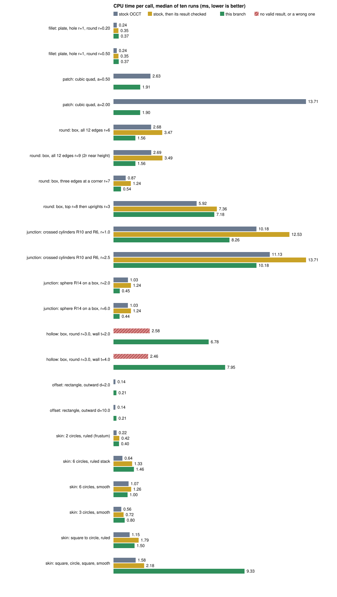

Median process CPU time of ten runs after one warm-up (`std::clock`), one thread, GCC 12.2 `-O3`, static
Release libraries, TBB off, AMD Ryzen 9 7950X3D on a shared host. The complete output with minima and maxima is
[operation-benchmark-results.txt](adm/scripts/extensions/operation-benchmark-results.txt); rerun it with
`adm/scripts/extensions/operation-benchmark.sh NATIVE_BUILD_DIRECTORY` and redraw the chart with
`operation-chart.py`. Checking a result (validity, volume, length) is excluded from the clock, **except** in the
bars called "stock, then its result checked". Those add the `BRepCheck_Analyzer` pass that every call of this
branch performs on its own result before returning it; stock does not, so that bar is the like-for-like
comparison for an operation that must return only valid bodies. Volumes are computed by adaptive Gauss-Kronrod
integration to 1e-8 (the default fixed rule is off by about 1e-5 on spline blends, which looks like a
difference between implementations and is not). Hatched bars are calls with no valid result or a wrong one.

| Operation | Input | Stock ms | Stock + check ms | Branch ms | Result |
| --- | --- | ---: | ---: | ---: | --- |
| Round | plate, hole r=1, edge r=0.2 / 0.5 | 0.28 / 0.30 | 0.58 / 0.59 | 0.75 / 0.89 | both exact to 5e-12 (closed form) |
| Round | box, all 12 edges, r=6 / r=9 | 3.2 / 3.1 | 4.0 / 4.6 | 2.3 / 2.1 | both exact to 3e-11 (Steiner) |
| Round | box, three edges at a corner, r=7 | 1.6 | 1.4 | 0.67 | same volume |
| Round | box, top r=8 then uprights r=3 | 7.2 | 8.5 | 9.0 | volumes differ by 0.48 of 22 140 (unexplained) |
| Round | crossed cylinders R10/R6, r=1 / 2.5 | 11.6 / 13.2 | 13.9 / 16.2 | 14.9 / 17.7 | volumes differ by 0.008 / 0.27 |
| Round | sphere R14 on a box, r=2 / 6 | 1.3 / 1.3 | 1.6 / 1.6 | 0.73 / 2.27 | volumes agree to 1e-7 |
| Fill | four cubic sides, a=0.5 / 2.0 | 3.7 / 17.9 | | 3.5 / 2.2 | stock 0.11 / 0.45 off the defining surface, branch 1e-12 |
| Hollow | filleted box, wall 2 / 4 | 2.9 / 2.7 | | 7.3 / 8.7 | stock volume wrong by 3.3e4 / invalid; branch exact to 1e-11 |
| Curve offset | rectangle, d=2 / 10 | 0.15 | | 0.25 / 0.27 | both exact |

How to read it, without flattering it:

* **Where the branch matches or beats the checked stock bar:** twelve-edge and corner rounds, the sphere on a box at
  radius 2, and the fill. These are within noise or faster, and agree with stock on the volume.
* **Where it is slower than that bar:** a single circular edge (1.3 to 1.5 times), the sphere at radius 6 (1.4 times),
  a round blended into earlier rounds and the crossed cylinders (1.05 to 1.1 times), the curve offset (1.7 times) and
  the hollow (2.5 to 3.5 times, against a stock call that returns a wrong or invalid body). A profile of the single
  circular edge shows the call is stock's builder (36 per cent) plus one validity pass (48 per cent) plus
  bookkeeping, so there the extra cost is the verification, not the construction; the remaining 0.2 ms is face
  history and the closedness test. Cheaper verification, or skipping it where the builder's result is provably
  unchanged, is open work.
* **Volume differences.** Both implementations return valid bodies where they differ by 0.008 to 0.5 in volume
  (2e-5 relative at most). Neither has a closed form to be judged against. They are consistent with the two blends
  being different approximations within their tolerances; this has not been established.
* **Fill and hollow** show the cases stock does not handle well, on inputs with closed forms; they say nothing about
  general loops.

A rigorous claim about speed or quality on general inputs needs a corpus rather than a dozen rows; the corpus used for
development belongs to the application and cannot be redistributed with this tree.

### Gallery

Results of the operations above, rendered from the meshes of the application that embeds this tree
(`scripts/render-fork-gallery.ts` there draws them with three.js; no part of the images comes from another
product). The scenes are the application's own fixtures.

| | |
| --- | --- |
| 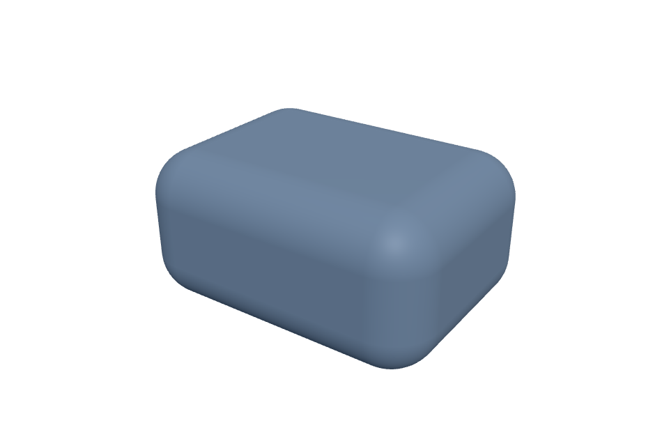 | 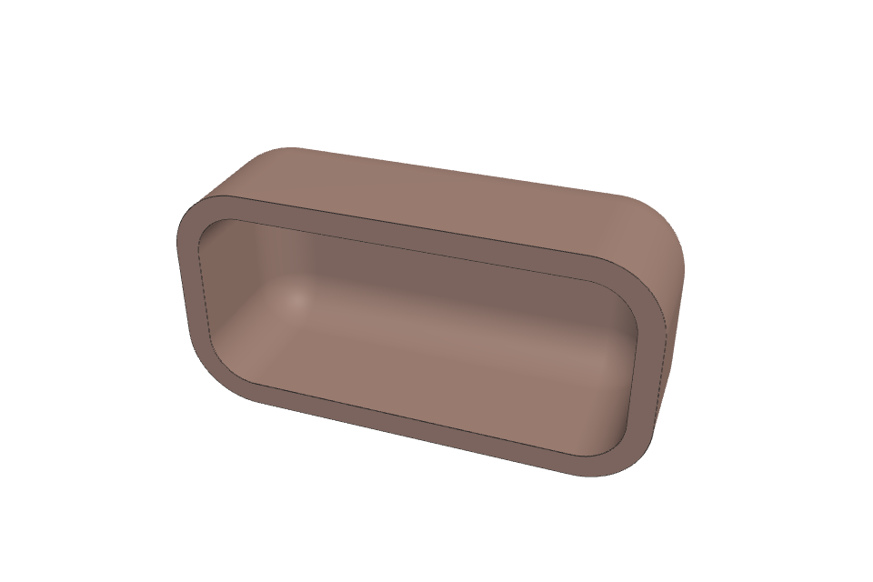 |
| Twelve edge blends meeting at eight corners (`BRepBlendExt`, `BRepFilletExt`). | The same body hollowed to a wall of 2 and cut in half (`BRepOffsetExt`). |
|  | 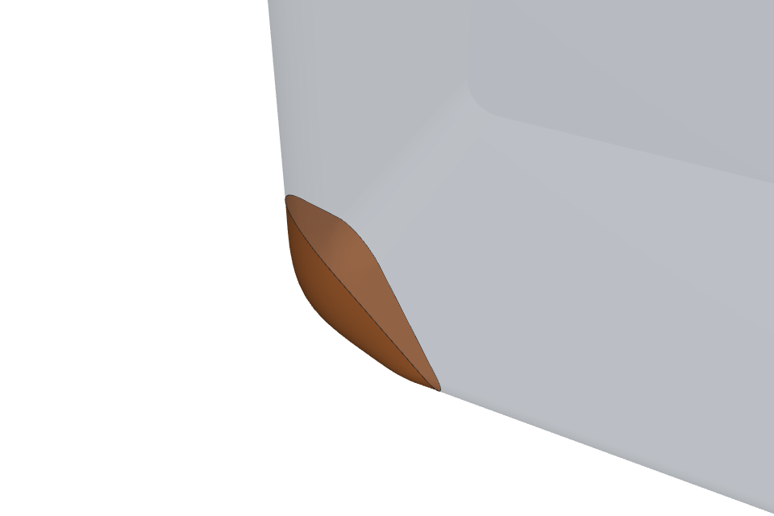 |
| A five-sided fill between free-form faces (`BRepPatchExt`; the neighbouring faces are the grey strips). | A fill at a corner of unequal, set-back rounds; the orange face joins the grey rounds smoothly. |

| | |
| --- | --- |
| 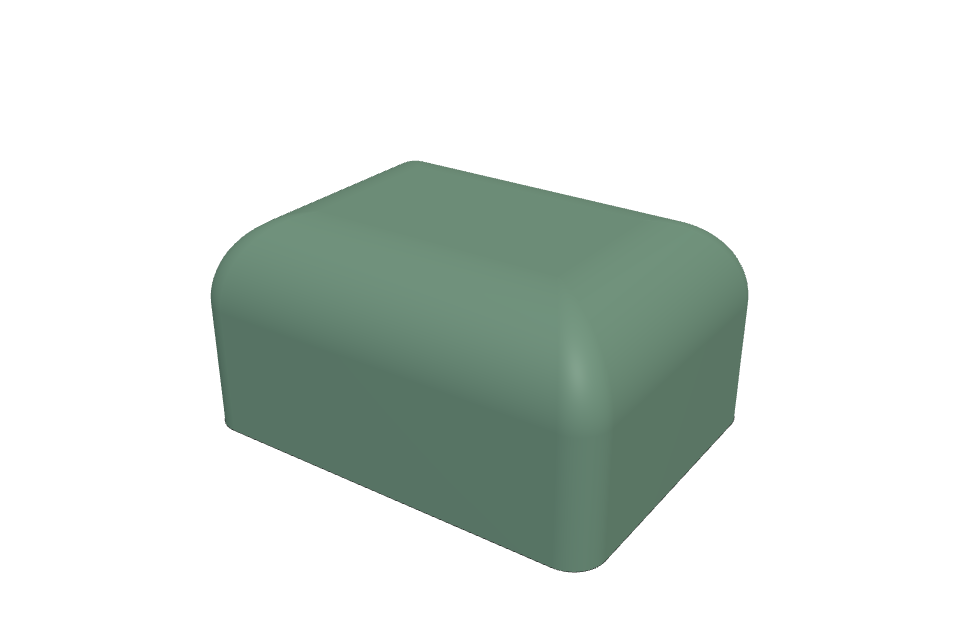 | 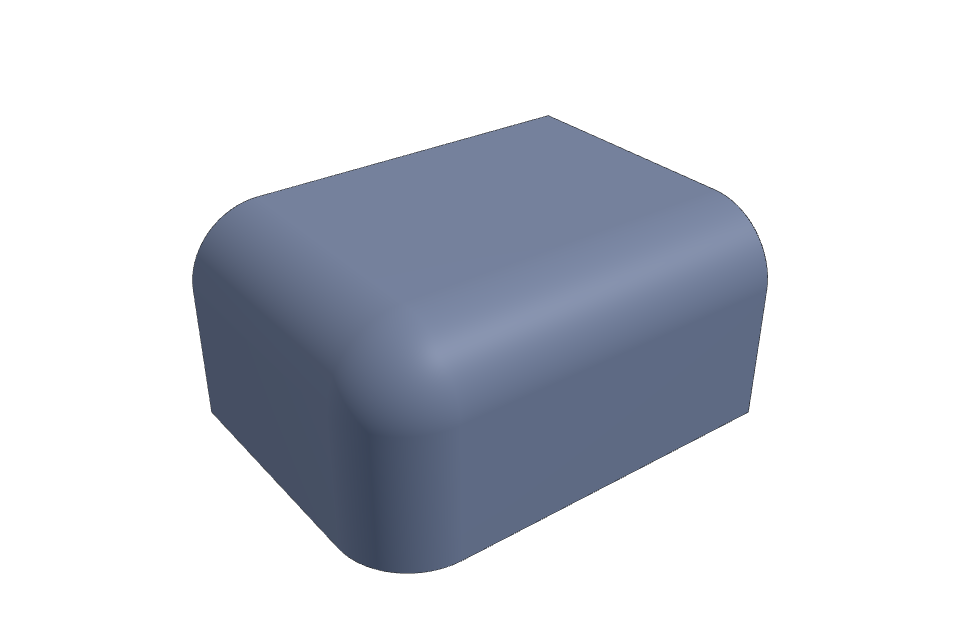 |
| Four small rounds on the uprights run into the four large rounds of the top face (rounds blended into existing rounds). | Three rounds of one radius meeting at a single corner. |
| 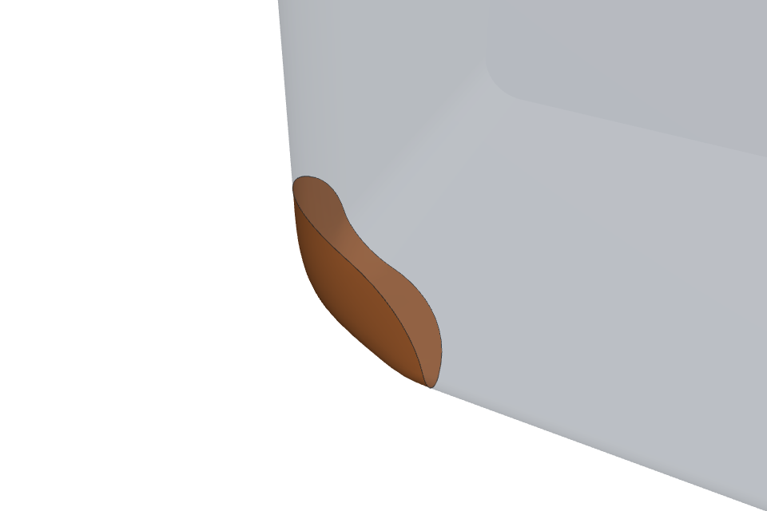 | 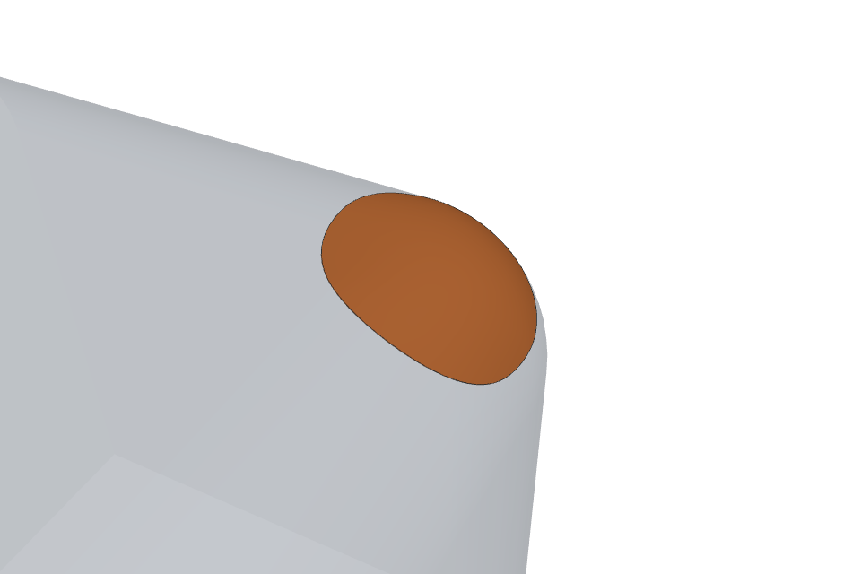 |
| A fill at the corner of three rounds of different radii; the orange face is tangent to all three. | A fill whose boundary lies on a plane, a cylinder and a sphere. |
|  |  |
| A three-sided fill between free-form faces. | A six-sided fill between free-form faces. |
| 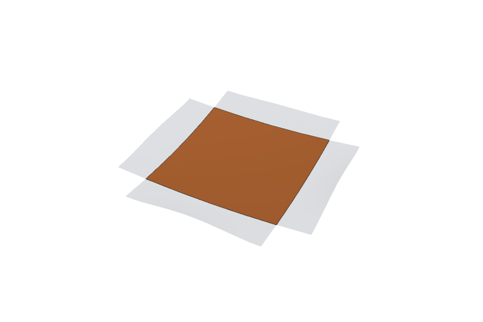 | 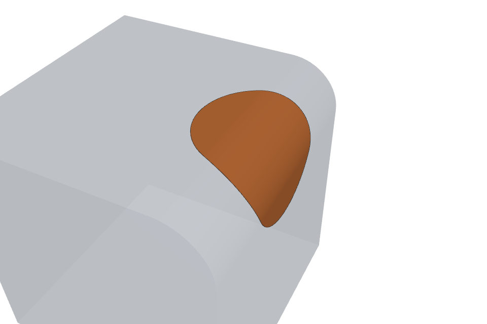 |
| A four-sided fill between spline faces. | A fill between a round and a flat face. |

| | |
| --- | --- |
| 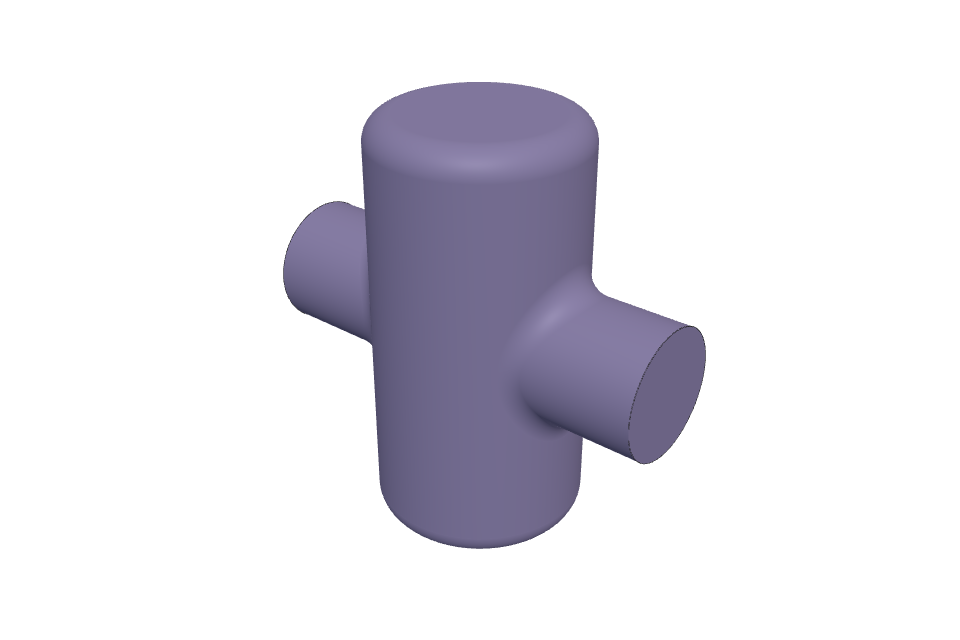 | 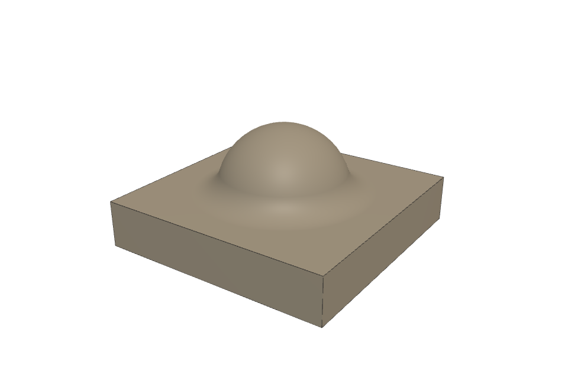 |
| Two crossing cylinders (R10, R6) with their intersection curves rounded by 2.5: the blend follows a space curve where two curved surfaces meet. | A sphere (R14) standing on a box with the circular junction rounded by 6. Stock and this branch agree on the volume to 1e-8 of it. |

Thirteen of the application's fifteen fill fixtures are delivered (the gallery draws all of them in
`scripts/render-fork-gallery.ts`; two are refused on purpose, one because no surface has the curvature of
both neighbours and one because a four-sided loop has a singular corner). Larger assemblies are **not**
supported yet: fills that must join a surface to later fills, networks of guide curves, fills bounded by open
curves with branching guides, and curvature-continuous fills across more than two faces at once. They appear
in the open work below, not in the images.

 The images are illustrations of what is
supported, not measurements; the numbers are in the benchmark above and in the tests.

### Open work

Known limits and what remains, stated without reference to any application:

1. **Blend solver.** Some configurations where several blends meet are refused although a valid result exists:
   the trimming of a blend group needs an owner for every retained region and contact before chain ends are cut,
   and the centre path must be parametrised consistently by arc length along the marched curve, not by the edge's
   parameter. Steep dihedral angles (above about 75 degrees) and curvature-continuous sections at five-sided
   corners are also refused.
2. **Section law for curvature continuity.** `BRepBlendExt_Policy` supplies the conic section only. A published bound for a
   curvature-continuous conic or quintic section as a function of the support's curvature is missing.
3. **Fill.** The interior acceptance gate and the flat-support curvature limit have no derivation. The fit's
   stopping decisions depend on rounding and therefore weakly on pose (sampled, not bounded). Fills through three profiles with
   curvature continuity can miss the curvature-share limit. Open boundaries need a host-supplied
   chaining routine (`BRepPatchExt_Side.hxx`).
4. **Offsets and thickening.** Thickening a sheet whose surface self-crosses is unproven for general splines;
   offsetting solids whose blends meet the wall thickness exactly has no exactness proof.
5. **Speed.** Every call verifies its result, and on small inputs that verification costs as much as the construction
   (table above). Making it cheaper, or skipping it where the builder's result is provably unchanged, is open. The curve
   offset and hollow are 1.7 and 2.5 to 3.5 times slower than stock and have not been profiled; skinning has not been
   compared with stock at all.
6. **Tests.** Native tests exist for the utilities, the chart, the fit and five whole operations. Most of
   `TKAlgoExt` is exercised only through the embedding application's tests; closed-form native tests are
   needed for each package before an upstream proposal.
7. **Conventions.** The packages use free functions in namespace `BRepExt`, a host seam and `std::runtime_error`
   failures. OCCT style would be classes with `IsDone`/`Shape`, `Standard_Failure` and `Message_ProgressRange`.
   That is a behaviour-changing refactor and is deferred to review.
8. **Provenance.** Four routines that were written against the observed behaviour of other software and two
   Patch routines are deliberately not in this tree.

## Applying modules separately

These modules do not depend on the 17 corrections. The accepted utility commits
remain unchanged. On this pinned base, apply the following commits in order:

| Module | Commits | Dependencies |
| --- | --- | --- |
| Spline fit, portable band, prepared rim/compaction | `bb5616bf41`, `58430e7900`, `dd709ae866` | accepted interval/Bernstein/bounds helpers; existing TKGeomAlgo→TKBRep dependency |
| Original fit/rim/compaction source replacement | `72b7c5f0a0` | replaces the prepared fit family above; preserves production symbols and polling; native progress/default hook member |
| Exact-section fitting | `a28ec1fd41` | spline-fit batch and accepted Hermite helper |
| Patch chart/interior | `3d1022a70e`, `4273531a63` | spline execution header; accepted Bernstein/interval helpers; existing TKMesh |
| Benchmark documentation | `01bba3caa2`, `f757b82e4c` | corresponding module headers for candidate binaries only |

Commit `dd709ae866` can be cherry-picked before the chart commit: it changes only
the spline basis status boundary. A module cherry-pick includes its own GTests and
FILES registration. If a package already exists, merge the additive FILES entries;
do not replace unrelated toolkit registrations. Native tests above were run on the
combined pinned branch, not on every independent commit combination or upstream tip.
The module benchmark script accepts separate candidate and stock static build trees.
Do not infer independent upstream-master compatibility from the correction branches.

## Reproducing the native measurements

Use Linux, CMake, Ninja, a C++17 compiler, and static Release libraries.
`adm/scripts/extensions/compare.sh BASE CANDIDATE OUTPUT_DIRECTORY` creates
independent worktrees, builds both, and runs the same benchmark source against
each. For this table BASE is `b8f597c6` and CANDIDATE is `14f92b09`.
To measure a correction alone, create a branch at BASE, cherry-pick only that
correction (and its listed dependency), and pass that branch as CANDIDATE.
The exception and null-curve commits are included in the aggregate candidate;
the native benchmarks do not exercise those WebAssembly/null paths.

The benchmark uses `std::clock()` process CPU time, one warm-up and ten measured
runs per case; setup is outside the clock except sphere construction in the mesh
case. Measurements: AMD Ryzen 9 7950X3D, GCC 12.2, `-O3`, TBB off, six CPU container
limit. These are observed medians, not complexity bounds or universal speedups.
The four finite fixtures do not exercise every correction. A build and unchanged
fixture result are not a triggering regression test for an unexercised correction.

Fixtures have independent checks: a 100×80×2 plate with 32 radius-one through holes
has volume `16000−64π` and area `16720+64π`; 20,000 face classification queries
are checked against the disk complement (19,760 inside). Filleting the top hole
edges by radius r=0.2 removes another `32π[2r²+(5/3)r³−(π/2)(1+r)r²]`.
This follows integrating `π[((1+r)−sqrt(r²−t²))²−1]` from t=0 to r
for each of the 32 quarter-circle profiles. The volume check runs outside
the measured interval. Classification checks the aggregate inside count. A radius-ten sphere meshed at
linear deflection 0.01 and angular deflection 0.1 checks mesh vertices against the
sphere. Its 10,176 triangles and filleted volume 15797.13503629154 were identical
between these two builds. These checks do not certify every topological invariant.

| Aggregate CPU median, ms | Stock same base | Corrections | Ratio |
| --- | ---: | ---: | ---: |
| Plate properties | 4.645 | 4.349 | 0.936 |
| Plate classification | 144.9025 | 4.829 | 0.0333 |
| Plate fillet | 11.2375 | 11.1585 | 0.993 |
| Sphere mesh | 34.020 | 26.987 | 0.793 |

Sample minima/maxima and per-correction values are in
[measurements.json](adm/scripts/extensions/measurements.json).
Every standalone same-base correction built and completed all four fixtures.
The analytic fillet-volume check was added after the first timing series, outside
the clock; a later aggregate rerun also passed it. Timed operation bodies are unchanged.
Noise and regressions in individual observations remain visible there. Each entry records
the ten-sample median and extrema, not every individual timing.

| One correction on stock base, CPU median ms | Properties | Classification | Fillet | Mesh |
| --- | ---: | ---: | ---: | ---: |
| Approx_BSplComputeLine-local-endpoint-parameters | 4.528 | 144.438 | 11.102 | 33.727 |
| BOPAlgo_RemoveFeatures-extend-across-feature | 4.468 | 143.753 | 11.858 | 33.534 |
| BRepAlgo_Loop-sort-vertices | 4.522 | 149.160 | 11.270 | 33.138 |
| BRepCheck_Solid-stop-after-enclosed-region | 4.422 | 141.957 | 11.589 | 33.758 |
| BRepFill_Draft-orientation-last-sample | 4.736 | 143.969 | 11.293 | 32.091 |
| BRepGProp_Gauss-used-errors | 4.368 | 147.476 | 11.118 | 32.648 |
| BRepMesh_Delaun-hilbert-insertion | 4.229 | 140.642 | 11.428 | 26.280 |
| BRepMesh_DelaunayDeflectionControlMeshAlgo-node-normals | 4.488 | 140.654 | 11.019 | 33.898 |
| Geom_OffsetSurfaceUtils-cancellable-progress | 4.447 | 144.507 | 11.335 | 33.918 |
| BRepOffset_MakeOffset-cancellable-tolerances | 4.328 | 146.446 | 10.976 | 33.206 |
| BRepOffset_MakeOffset-input-order | 4.363 | 142.315 | 11.386 | 32.689 |
| BRepTopAdaptor_FClass2d-wire-bounds | 4.533 | 5.003 | 11.198 | 32.855 |
| Extrema_ExtPExtS-spline-across | 4.656 | 145.131 | 11.127 | 32.544 |
| IntTools_BeanFaceIntersector-whole-range | 4.953 | 143.904 | 11.118 | 33.328 |
| IntTools_EdgeFace-line-plane-touch | 4.219 | 146.035 | 11.046 | 32.903 |
| IntTools_FaceFace-plane-across-sweep | 4.532 | 151.938 | 10.979 | 32.733 |
| TopOpeBRepBuild_WireEdgeClassifier-box-apart | 4.662 | 144.457 | 10.789 | 35.466 |

## Corrections, derivations and independent application

For each commit: `git switch -c review-N b8f597c6; git cherry-pick COMMIT`.
All are independent except offset tolerance cancellation, which needs the
`Geom_OffsetSurfaceUtils` progress guard first. Existing OCCT tolerances and
limits are retained unless the entry explicitly identifies an added constant.
These are elementary derivations unless a paper reference is named; they are
not claims of formal machine-checked proofs.

Upstream assessment was against official `master` `53706f78a8640c4407bdcc6752df13a270b159f2`.
Branches `upstream/ID` contain one correction each; the loop sorting branch only
adapts include context. Thirteen branches compiled independently. Offset tolerance
cancellation requires the progress guard and is not independently compilable;
`upstream/BRepOffset-cancellable-with-progress` contains both commits and also builds.
Three changes conflict with redesigned upstream implementations and are left
unported rather than making an unsupported semantic adaptation.

### Approx_BSplComputeLine-local-endpoint-parameters

Commit `806f921d8abf23864e4ef0de270f4ac340e653db`. Upstream: applies; native toolkit build passed.

Problem: Endpoint fitting previously mixed physical parameters with normalized local coordinates.

Derivation and limits: For a positive local span h=b-a, s=(t-a)/h and dC/dt=(dC/ds)/h. Solve the endpoint Bezier fit on [0,1] and rescale both endpoint tangents by h. Assumes strictly increasing endpoint parameters. No new threshold or sampling count.

### BOPAlgo_RemoveFeatures-extend-across-feature

Commit `af44c0a7023a37f38c904010e99b5c64630523bb`. Upstream: applies; native toolkit build passed.

Problem: Extending both directions unnecessarily enlarges adjacent face domains during feature removal.

Derivation and limits: On a forward face an oriented parameter tangent (du,dv) has outward transverse direction (dv,-du). Extend only coordinates with a nonzero outward component; a missing pcurve retains the full extension. This local derivation does not prove that five samples capture every tangent on a curved edge. Four subintervals are an unproven sampling choice. Existing angular and geometric resolutions are retained.

### BRepAlgo_Loop-sort-vertices

Commit `2c9b2590d8d4f695a5a33899ed545f334c233978`. Upstream: applies; native toolkit build passed.

Problem: Repeated parameter evaluation and adjacent exchange sorting take quadratic work.

Derivation and limits: Deduplicate in encounter order, evaluate each remaining parameter once, then stable-sort it. For finite parameters this preserves the stable order of the adjacent exchange sort, including equal parameters, while reducing sorting comparisons from quadratic to O(n log n). Assumes the shape map equality agrees with the old duplicate comparison. No new geometric constants.

### BRepCheck_Solid-stop-after-enclosed-region

Commit `561fa613b4d90aa2d0ce3db2c38a53b188b0cb2b`. Upstream: applies; native toolkit build passed.

Problem: Continuing after an enclosed-region error reaches classifiers that were never initialized.

Derivation and limits: Once a second growth shell adds EnclosedRegion, later classifiers have not been initialized. Return before their use. The already-recorded invalidity is retained; no claim is made about collecting further diagnostic errors. No new constants.

### BRepFill_Draft-orientation-last-sample

Commit `2401e8b9212b9695045f34ade8f006c8daa0425e`. Upstream: applies; native toolkit build passed.

Problem: Rounded final abscissae can exceed the wire length and query an absent location law.

Derivation and limits: Exact sample positions satisfy 0 <= (i-1)*length/N <= length. Floating-point multiplication can place the endpoint outside this closed interval. min(sample,length) restores the endpoint bound and prevents querying an absent location law. Interior arithmetic and sample count are unchanged. No new constants.

### BRepGProp_Gauss-used-errors

Commit `bcf74fe6c586fd395899c34da690a9498cdba0ce`. Upstream: not ported: changed upstream implementation.

Problem: Adaptive integration searched unwritten zero-initialized error capacity.

Derivation and limits: The error vector has an explicitly zero-initialized suffix. Its maximum is the prefix maximum unless that is negative, in which case the first suffix zero wins. Scan the used prefix with the same strict comparison and reproduce that suffix case. This retains the selected integration interval and arithmetic. No new numerical constants.

### BRepMesh_Delaun-hilbert-insertion

Commit `3fa3feb2d4fead0288224bc6812f68087c01f4a2`. Upstream: applies; native toolkit build passed.

Problem: Geometrically scattered insertion order makes mesh refinement expensive.

Derivation and limits: Map the parameter box to a 16-bit square grid and order nodes by recursive quadrant rotation, breaking ties by node index. This is an ordering change only; deflection controls are unchanged. Locality is a performance heuristic, not a runtime theorem. The 16-bit grid (65535 maximum, loop starts at bit 15) is an unproven resolution choice; triangle connectivity and sampling may change.

### BRepMesh_DelaunayDeflectionControlMeshAlgo-node-normals

Commit `e80dd7d596030b3dfead2994718d167fea2ba65d`. Upstream: not ported: changed upstream implementation.

Problem: Repeated normal estimation at unchanged mesh nodes duplicates work.

Derivation and limits: For an unchanged surface and identical parameter pair, NormEstim is the same deterministic function call. Cache its value and defined flag keyed by node index plus exact parameter coordinates, invalidating between optimizations. Coordinate validation prevents stale results after index reuse. No tolerance, angular limit or normal formula changes.

### Geom_OffsetSurfaceUtils-cancellable-progress

Commit `6593918e73854db64fd1d3e8729956320d05bca2`. Upstream: applies; native toolkit build passed.

Problem: Offset normal retries can stop making representable progress without observing cancellation.

Derivation and limits: An iteration with unchanged stored parameters evaluates the same normal again and cannot advance. Reject nonfinite or nonrepresentable steps without an iteration bound; retain arithmetic for progressing steps. A borrowed thread-local Message_ProgressRange is scoped by RAII, so nested evaluations restore their callers even on exceptions. No new numerical constants.

### BRepOffset_MakeOffset-cancellable-tolerances

Commit `bdd6b9a822298b88f5792a3ca51bb44c272ab112`. Upstream: applies textually; requires progress-guard dependency to build.

Problem: Edge tolerance sampling lacked cancellation and loaded derivative-dependent adaptors unnecessarily.

Derivation and limits: Positional D0 evaluation uses only the loaded pcurve and surface, not the endpoint derivative adaptors. Load curve then surface and retain all positional samples and arithmetic. Check the progress range before applying incomplete tolerance results. Depends on the offset evaluation progress guard. The new progress weight 1 is an unproven presentation share, not a geometry bound or deadline.

### BRepOffset_MakeOffset-input-order

Commit `b0456807767b5c4e2017882573a2c92cdce0ecfe`. Upstream: applies; native toolkit build passed.

Problem: Offset root traversal depended on allocation-sensitive map order.

Derivation and limits: Sort map entries by TopExp input index before building their generated faces. The traversal becomes a function of input topology instead of allocation addresses, provided every key has an input index. Stable sorting retains existing order for equal indices. No tolerance or geometric constant changes.

### BRepTopAdaptor_FClass2d-wire-bounds

Commit `c8c90a2c33699ec7e532d9614a42ba953fc36357`. Upstream: not ported: changed upstream implementation.

Problem: Using a face-wide box for each wire prevents rejecting unrelated holes cheaply.

Derivation and limits: A polygon lies in the coordinate-wise extrema of its vertices. A query outside that box beyond the classifier tolerance cannot be inside the polygon. Use that wire box for quick rejection while retaining the identical polygon ray test inside and the old fallback for zero-area bounds. No new constants.

### Extrema_ExtPExtS-spline-across

Commit `a71c466051d1aba6fe3aa7227f5bea26488e921e`. Upstream: applies; native toolkit build passed.

Problem: A generic surface extremum solve ignores separability of transverse spline extrusions.

Derivation and limits: For unit D and C(u).D=h constant, S(u,v)=C(u)+vD gives squared distance ||P-h_proj-C(u)||^2+(v-v0)^2. The interior minimum therefore separates into a curve projection and v=v0. Keep the generic path for boundary or unresolved cases. Existing capacity of four extrema is retained: this does not promise every boundary or non-nearest extremum. Existing tolerances are unchanged.

### IntTools_BeanFaceIntersector-whole-range

Commit `dc671c167bc420983b58647b6871781decc0e297`. Upstream: applies; native toolkit build passed.

Problem: Localized edge/face searches may omit intersections outside their selected neighborhood.

Derivation and limits: Use the existing whole-range search for all surface kinds instead of choosing a localized search for certain polynomial surfaces. Both seek the same zero distance locus; no theorem guarantees completeness of the numerical global search. This preserves the previously selected implementation, not a new intersection algorithm. No new constants.

### IntTools_EdgeFace-line-plane-touch

Commit `def5b1740c39f3d443ba016837ee18cf13f35393`. Upstream: applies; native toolkit build passed.

Problem: Numerical touch detection can miss the analytic interior intersection of a line and a plane.

Derivation and limits: For L(t)=p+td and plane (x-q).n=0, t=(q-p).n/(d.n) when d.n is nonzero. Use that intersection only inside both trimmed parameter ranges, retaining the generic extrema search elsewhere. Angular nonparallel recognition uses the existing Precision value. No new thresholds.

### IntTools_FaceFace-plane-across-sweep

Commit `5ce72fca97a8b6313e019f52cb876d884ca96e0f`. Upstream: applies; native toolkit build passed.

Problem: The generic section search loses the exact translated-curve construction of transverse extrusions.

Derivation and limits: For S(u,v)=C(u)+vD, D parallel to plane normal n, and C(u).D constant, v=(q-C(u0)).n/(D.n) is constant. Translate the basis curve by vD; its extrusion pcurve is (u,v). Preserve boundedness for section endpoints, and retain the general path near trimmed ends. Assumes positive-weight spline poles for the constant-height hull argument. Existing OCCT tolerances only.

### TopOpeBRepBuild_WireEdgeClassifier-box-apart

Commit `14f92b09b402c6fcfcbc95129e6a329b4184372e`. Upstream: applies; native toolkit build passed.

Problem: Wire classification performs expensive curve tests even for disjoint parameter boxes.

Derivation and limits: A loop is contained in the bounds of all its existing pcurves. If two expanded boxes are disjoint, one loop is in the unbounded complement of the other box and can reuse its outside classification. Missing pcurves and block classification keep the old path. The outside probe uses xmax+width+1; 1 is an unproven positive displacement, not an error bound. UV expansion retains stored edge tolerances and therefore inherits their unit assumptions.

The Hilbert ordering uses the locality concept discussed in [4]; its grid resolution
remains a heuristic.

## Finite mathematical utilities

The originally extracted utility subset consists of header-only helpers using
OCCT and the C++ standard library. These helpers neither report application
errors nor own an application journal. Their bounded local calculations have no
long-running solver loop needing a progress range. The larger solver modules
described above have separate native failure and progress contracts; their
application integration remains subject to the stated boundary gates.

* `GeomAlgoExt_Bernstein.hxx`: for Bernstein basis `B_i^n`,
  `B_i^n B_j^m = binom(n,i) binom(m,j) / binom(n+m,i+j) B_(i+j)^(n+m)`.
  Degree elevation is the corresponding multiplication by the constant one.
  Tensor-product extension applies the identity in each coordinate [1].
  The cached Pascal table size 96 is an **unproven performance cutoff**.
  Floating coefficient accumulation is not a certified global error bound.
* `GeomAlgoExt_Interval.hxx`: for finite stored IEEE binary64 endpoints, evaluate
  endpoint operations and expand each rounded result by one adjacent representable
  number. The enclosure follows correct round-to-nearest and monotonicity; a
  product needs the four endpoint combinations [2]. Reject nonfinite results.
  This assumes no unsafe reassociation, overflow acceptance, or altered rounding.
  Binary64 precision 53 is derived from the representation, not a fitted constant.
* `GeomAlgoExt_UniformKnots.hxx`: a degree-p clamped spline has endpoint
  multiplicity p+1; its interior simple knots divide the finite interval into
  equal spans. Assumes nonnegative degree, positive span count, finite endpoints.
* `GeomAlgoExt_Hermite.hxx`: convert value and derivative constraints into rows of
  the B-spline collocation matrix using OCCT's basis evaluation, then solve the
  three coordinate right-hand sides. Knot multiplicities and derivative scaling
  follow spline differentiation [3]. A singular matrix returns failure; neither
  invertibility nor floating conditioning is promised for arbitrary constraints.
* `GeomAlgoExt_CubicThrough.hxx`: for distinct increasing sites, a natural C²
  cubic interpolant minimizes integral |s''|² over H² interpolants. Writing
  another interpolant as s+e, integrate each span twice: the fourth derivative is zero, e vanishes at
  sites, s'' is continuous internally and zero at the ends. Thus integral s''e''=0
  and E(s+e)=E(s)+E(e). The implemented tridiagonal system and cubic Bernstein
  controls follow the first/second derivative equations; coefficients 2, 3, 1/2
  and 3/2 and degree/multiplicity 3/4 are derived. Closed and tangent-constrained
  variants have their own endpoint equations, not the natural-boundary theorem.
  `unify` retains an **unproven 1e-12 knot merge threshold**.
* `GeomAlgoExt_ParameterRectangle.hxx`: a positive-weight rational B-spline lies
  in its control hull [1,3]. Bound each parameter pcurve and recognize a full
  rectangle under the existing valid-face and boundary assumptions. This is not
  a global topology certificate. **64 epsilon** and **1e-12 times span** are
  inherited **unproven recognition allowances**, not mathematical bounds.
* `GeomAlgoExt_SurfaceBounds.hxx`: split a B-spline into Bezier patches and take
  coordinate-wise control hull extrema [1,3]. Positive weights are required for
  the rational hull argument. The inherited conversion allowance **1e-10 is
  unproven**; the hull theorem does not prove the conversion error.

Native time for the new helper APIs versus stock has not been measured: stock has
no identical entry points. The integration comparison isolates relocation without
changing their implementation; the first two batches produced identical WASM bytes.
The native utility oracle runner is `adm/scripts/extensions/utilities.sh BUILD_DIRECTORY`.
It checks independent polynomials, long-double inclusions, endpoint jets and hull containment.

No numerical threshold was changed by relocating these utilities. The source
identifiers changed mechanically to the package namespace. Host integration
proof compares exact serialized B-reps and typed refusals against the installed
starting release, rather than rebaselining changed geometry.

## Sources actually consulted

[1] Rida T. Farouki (2012), “The Bernstein polynomial basis: A centennial
retrospective”, Computer Aided Geometric Design 29(6), 379–419.
[Author manuscript](https://www.researchgate.net/profile/James-Peters-3/post/Since_the_Bernstein_basis_is_more_stable_than_the_1_x_x2_x3_basis_why_do_we_use_the_second_one/attachment/59d62e4cc49f478072e9ef35/AS:273573887840257@1442236505726/download/Farouki-on-Berstein-basis-2012.pdf),
degree elevation/product formulas and convex hull sections. The floating-point
implementation does not inherit an exact-arithmetic theorem without rounding analysis.

[2] Siegfried M. Rump (2010), “Verification methods: Rigorous results using
floating-point arithmetic”, Acta Numerica 19, 287–449.
[Author manuscript](https://www.tuhh.de/ti3/rump/intlab/ActaNumerica2010.pdf),
sections 2, 4 and 5.5 on IEEE arithmetic, directed rounding and inclusion.
The finite stored-double helper is narrower than general interval arithmetic.

[3] Carl de Boor (1972), “On calculating with B-splines”, Journal of Approximation
Theory 6(1), 50–62. DOI [10.1016/0021-9045(72)90080-9](https://doi.org/10.1016/0021-9045(72)90080-9).
[Read paper](https://ftp.cs.wisc.edu/Approx/bsplcalc.pdf), recurrence and convex combinations.

[4] John Skilling (2004), “Programming the Hilbert curve”, AIP Conference
Proceedings 707, 381. DOI [10.1063/1.1751381](https://doi.org/10.1063/1.1751381).
[Read transcription](https://doczz.net/doc/7960692/programming-the-hilbert-curve).
This supports the locality construction concept. The implemented two-dimensional
quadrant rotation is not a claim to reproduce Skilling's global Gray-code algorithm;
no speed theorem follows from the citation.

## License and contribution review

New utility files identify Timon Gentzsch as author and use OCCT's LGPL-2.1 terms
with its exception. Existing OCCT files retain their existing notices.
Upstream's own [contribution workflow](dox/contribution/contribution_workflow/contribution_workflow.md)
states: “Before contributing, you must sign the Contributor License Agreement (CLA).”
It requests contributions to IR, a `<Group> - 
` title and review/testing.
No CLA has been signed by preparing this local branch. Ownership and authority to
license the extracted application sources must be confirmed before publication.
Original OCCT project information is preserved below.

---

# Open CASCADE Technology

Open CASCADE Technology (OCCT) is a software development platform providing services for 3D surface and solid modeling, CAD data exchange, and visualization. Most of OCCT functionality is available in the form of C++ libraries. OCCT is ideal for developing software dealing with 3D modeling (CAD), manufacturing/measuring (CAM), or numerical simulation (CAE).

## License

Open CASCADE Technology is free software; you can redistribute it and/or modify it under the terms of the GNU Lesser General Public License version 2.1 as published by the Free Software Foundation, with a special exception defined in the file `OCCT_LGPL_EXCEPTION.txt`. Consult the file `LICENSE_LGPL_21.txt` included in the OCCT distribution for the complete text of the license.

Alternatively, Open CASCADE Technology may be used under the terms of the Open CASCADE commercial license or a contractual agreement.

**Note:** Open CASCADE Technology is provided on an "AS IS" basis, WITHOUT WARRANTY OF ANY KIND. The entire risk related to any use of the OCCT code and materials is on you. See the license text for a formal disclaimer.

## Packaging

You can receive certified versions of OCCT code in different packages:

- **Snapshot of Git repository:** Contains C++ header and source files of OCCT, documentation sources, build scripts, and CMake project files.
- **Complete source archive:** Contains all sources of OCCT, generated HTML and PDF documentation, and ready-to-use projects for building on all officially supported platforms.
- **Binary package (platform-specific):** In addition to the complete source archive, it includes binaries of OCCT and third-party libraries built on one platform. This package allows using OCCT immediately after installation.

Certified versions of OCCT can be downloaded from:
- [Open CASCADE Releases](https://dev.opencascade.org/release)
- [GitHub Releases](https://github.com/Open-Cascade-SAS/OCCT/releases)

You can also find OCCT pre-installed on your system or install it from packages provided by a third party. Note that packaging and functionality of such versions can be different from certified releases. Please consult the documentation accompanying your version for details.

## Documentation

Documentation is available at the following links:
- [Latest version](https://dev.opencascade.org/doc/overview)
- [Version 8.0](https://dev.opencascade.org/doc/occt-8.0.0/overview)

Documentation can be part of the package. To preview documentation as part of the package, open the file `doc/html/index.html` to browse HTML documentation.

If HTML documentation is not available in your package, you can:

- **Generate it from sources:** You need to have Tcl and Doxygen 1.8.4 (or above) installed on your system and accessible in your environment (check the environment variable PATH). Use the batch file `adm/gendoc.bat` on Windows or the Bash script `adm/gendoc` on Linux or OS X to (re)generate documentation.
- **Generate together with sources:** You need to have CMake and Doxygen 1.8.4 (or above) installed on your system. Enable `BUILD_DOC_Overview` CMake parameter and set the path to Doxygen `3RDPARTY_DOXYGEN_EXECUTABLE`. Then build ALL or only `Overview`.
- **Read documentation in source plain text (Markdown) format** found in the subfolder `dox` or [GitHub Wiki](https://github.com/Open-Cascade-SAS/OCCT/wiki).

See [dox/build/build_documentation/building_documentation.md](dox/build/build_documentation/building_documentation.md) or [Building Documentation](https://dev.opencascade.org/doc/occt-8.0.0/overview/html/build_upgrade__building_documentation.html) for details.

## Building

In most cases, you need to rebuild OCCT on your platform (OS, compiler) before using it in your project to ensure binary compatibility.

Consult the file [dox/build/build_occt/building_occt.md](dox/build/build_occt/building_occt.md) or [Building OCCT](https://dev.opencascade.org/doc/overview/html/build_upgrade__building_occt.html) or [Building OCCT Wiki](https://github.com/Open-Cascade-SAS/OCCT/wiki/build_upgrade) for instructions on building OCCT from sources on supported platforms.

## Version

The current version of OCCT can be found in the file [`adm/cmake/version.cmake`](adm/cmake/version.cmake).

## Development

### Bug Tracker
- [GitHub Issues](https://github.com/Open-Cascade-SAS/OCCT/issues)
- [OCCT Tracker](https://tracker.dev.opencascade.org/)

For information regarding OCCT code development, please consult the official OCCT Collaborative Development Portal:
- [OCCT Development Portal](https://dev.opencascade.org)

### Forum and Discussions
- [OCCT Forums](https://dev.opencascade.org/forums)
- [GitHub Discussions](https://github.com/Open-Cascade-SAS/OCCT/discussions)

### Contour seeds and prism diagnostics

`BRepAlgoExt_Contours` enumerates a maker's propagated contour and chooses a
periodic spline's closing knot as a deterministic seed. It does not change the curve.
`BRepAlgoExt_Prism` supplies conservative diagnostics following a failed construction.
A planar set contained by a strip of width w cannot contain a disk of diameter
2r > w: this proves the cap-collapse implication for the recognized right prisms.
The curvature diagnostic solves det(II-k I)=0 using exact surface derivatives;
it is a sampled diagnostic, not a certificate between samples.
Assumptions: regular support derivatives and correctly recognized prism supports.
The inherited allowances are **unproven**: fineAngle=1e-12; strip slack=2e-7;
squared differential cutoffs 1e-20 and 1e-24; classifier steps 1e-4,1e-3,1e-2
and tolerance 1e-8; 4096 samples (one for constant-curvature elementary supports);
curvature-ratio allowance 1e-7. No value was retuned in this relocation.
These depend on TKMesh/TKGeomAlgo and the inherited Resolution header; they can
be applied independently of the patch solver. There is no whole-fillet impact
measurement here: construction remains in the application, and this source move
is validated by identical linked production bytes rather than a new speed claim.

### Surface differential jets

`GeomAlgoExt_SurfaceJet` retains the production first and second derivatives,
normal orientation, one-sided spline evaluation and curvature comparison. For
J=[Su Sv], I=J^T J and IIij=n dot Sij, coefficients of an ambient tangent t
are I^-1 J^T t. Thus II(a,b) is evaluated in parameter coordinates without
assuming an orthonormal parametrization. The maximum absolute directional
curvature difference of symmetric 2x2 D is |tr(D)/2|+hypot((D11-D22)/2,D12).
One-sided U derivatives use adjacent distinct knots; V uses its containing span.
Assumptions: regular differentials and compatible tangent planes for comparison.
Inherited **unproven** cutoffs: det(I)<=1e-24, normal magnitude<1e-15 and
curvature scale>1e-15. They are not a scale-invariant singularity theorem.
The polynomial GTest has independent piecewise graph derivatives at C1 joins,
including the V-span choice and reversed normals. This header needs TKGeomAlgo
and Failure only, and can be applied independently. Production byte identity
proves relocation adds no cost; whole surface-operation impact remains unmeasured.

`GeomAlgoExt_FitDiagnostics` uses those jets to report fixed-parameter residuals
and normal angles, signed projected Jacobian, and composite-trapezoid bending
energy (||Suu||²+2||Suv||²+||Svv||² in normalized parameters, scaled by length²).
The inherited 32x32 cell grid (1089 vertices), reference-area squared cutoff
1e-24 and minimum initialization 1e100 are **unproven operational choices**.
Sampling is not a global regularity or residual certificate. No fit policy changes.

### Planar curve containment

`GeomAlgoExt_PlanarCurve` transforms the trimmed curve into the supplied plane
frame and asks OCCT's optimal curve bound for [zmin,zmax]. The test
max(|zmin|,|zmax|)<=tolerance is necessary and sufficient for this bound to lie
in the tolerance slab. It uses the caller's tolerance and stock OCCT's extrema
algorithm, with no new sampling count or constant. Its guarantee assumes OCCT's
bound encloses the curve. Unsupported extrema retain stock behavior.
This header depends only on TKGeomAlgo and Failure; whole curve editing entry
points remain application-owned. Relocation itself adds no work.

### Trim integration, read-back and stored tolerance surveys

`BRepAlgoExt_TrimDomain` partitions rational boundary arcs into v-monotone
pieces. For Y/W, v' has numerator Y'W-YW'; Bernstein hull subdivision isolates
its zeros. Horizontal crossings define trimmed intervals, integrated with
embedded Gauss 7/Kronrod 15 rules for area and first moments. Volume uses
the divergence identity V=(1/3) integral (p-origin) dot n dA. Near square-root
end behavior, v=lo+width*sin²(t) regularizes the endpoint.
Assumptions: readable valid trim, regular finite carrier and usable positive
weights for convex-hull reasoning. Classification can refuse Unknown. The
embedded difference is an error estimate, **not a rigorous enclosure**.
The nodes/weights match the primary QUADPACK `dqk15` routine by Robert Piessens
and Elise de Doncker (1980, revised 1983), read at
https://netlib.org/quadpack/dqk15.f (table computed by L. W. Fullerton, 1981).
Its affine rule is used; its separate resasc/machine-error estimator is not.
Bernstein identities use de Boor [3]; these are not a proof of the stopping policy.
**Unproven choices retained:** station merge and horizontal-piece cutoff 1e-13;
relative root floor 1e-14; root depth 42; boundary-box depth 40; classifier
1e-12; crossing residual 1e-15, parameter width 1e-16 and 100 iterations;
quadrature depth 18, two-million call budget, relative budgets 1e-8(area) and
1e-11(volume), split 0.1 inner/0.9 outer; scale floor 1e-300.

`BRepAlgoExt_ReadBack` retains geometry normalization and trimming removal.
It searches for fixed points of the stock reader's normalization, preserving
unchanged input geometry in `settleNew`. Its 8 normalization iterations,
8-ULP coordinate search, 256 frame rotations at 1e-13 radians, and 8 conic
settling iterations are **unproven search limits**. Existence and global error
bounds are not claimed; fallback remains unchanged.
`BRepAlgoExt_Tolerance` returns stored vertex/edge/face tolerances, then their
maximum over the shape; containers have zero and nonfinite values map to infinity.
It introduces no document tolerance or floor. All three depend on TKMesh's
existing topology dependencies. Their native tests use exact eccentric-hole
moments, nested stored maxima and independent repeated reader normalization.
These source moves add no operation or new numeric policy; stock whole-operation
CPU/quality comparisons remain future work, not an inferred speedup.

`BRepAlgoExt_Properties` owns the original adaptive boundary property core and
analytic rectangular-face areas. The application includes this source inside its
original translation unit, retaining visibility of its local helpers for host
wrappers. Native CMake compiles the same file independently. The app's IDs and
publication logic stay outside it. Areas integrate ||Su cross Sv||; signed
volume integrates (p-origin) dot (Su cross Sv)/3. Rectangles of elementary
surfaces use their analytic Jacobian integrals, excluding cone-apex crossings
and spindle tori. Other paths retain their quadrature/fallback policy.
The boundary quadrature is a numerical estimate, not a rigorous certificate.

Property-core **unproven choices retained:** Gauss order 8; adaptive interval
cutoff 1e-14; noise floors 1e-12 and 1e-14; area relative budget 1e-8;
volume relative budget 1e-11 and floor 1e-24; relative volume noise 1e-13 and
noise share 1e-3; inner/outer divisors 10 and 100; derivative cutoff 1e-18;
stock area fallback tolerance 1e-9; adaptive depth 18 and two-million evaluations.
Gauss nodes and weights derive from Legendre polynomial exactness, not empirical
geometry data. The new sphere-rectangle oracle uses r² du (sin(v1)-sin(v0)).
