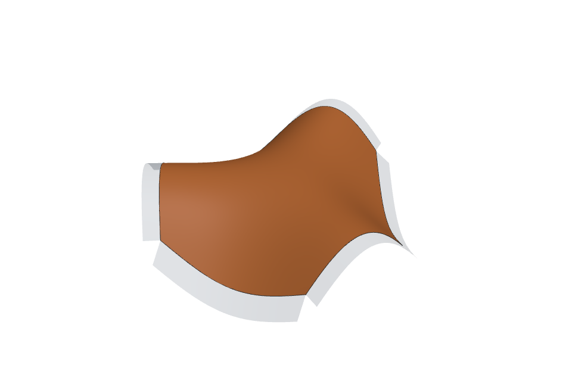
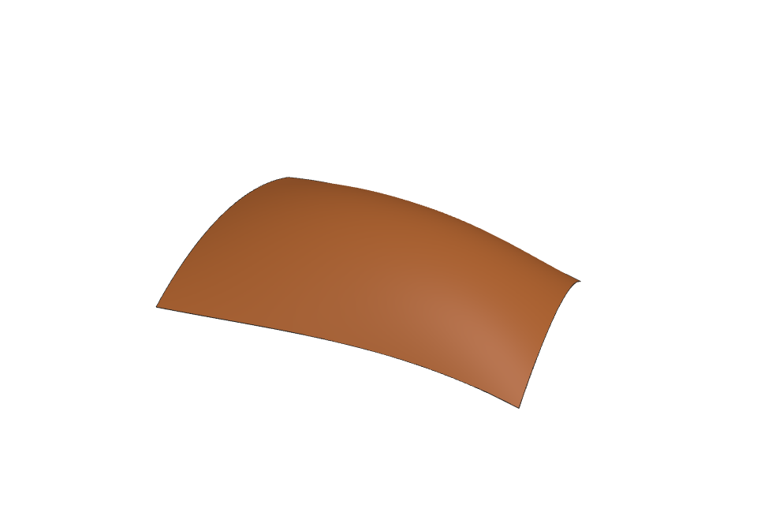
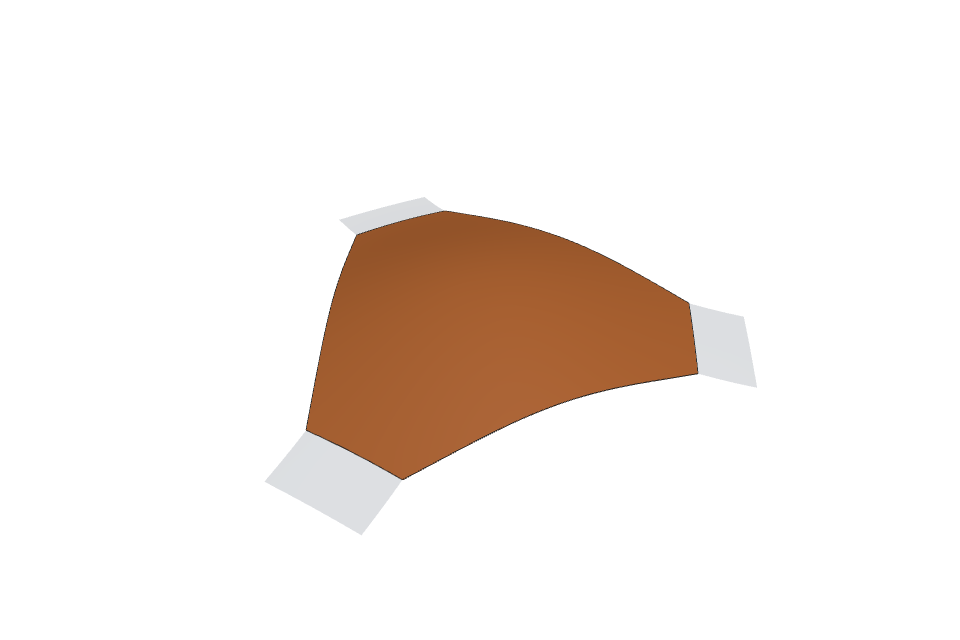
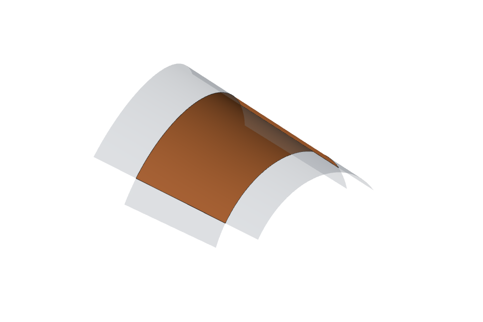
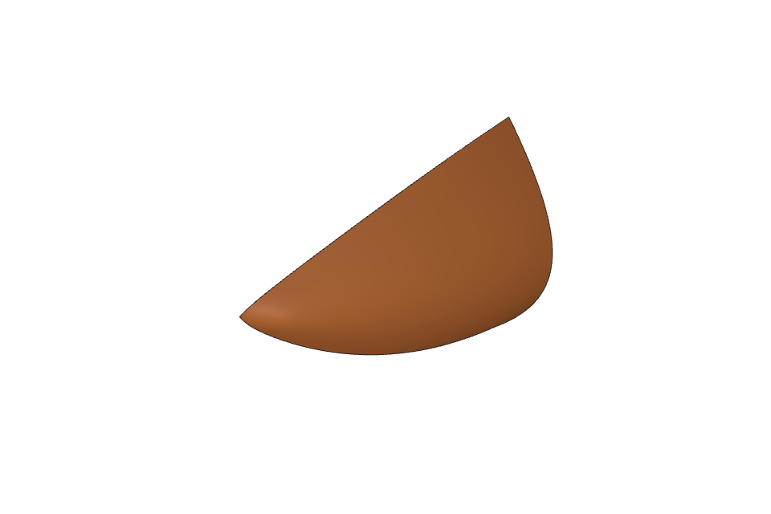
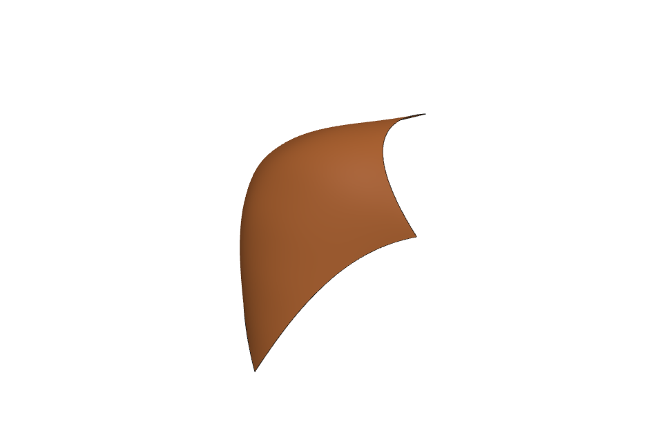
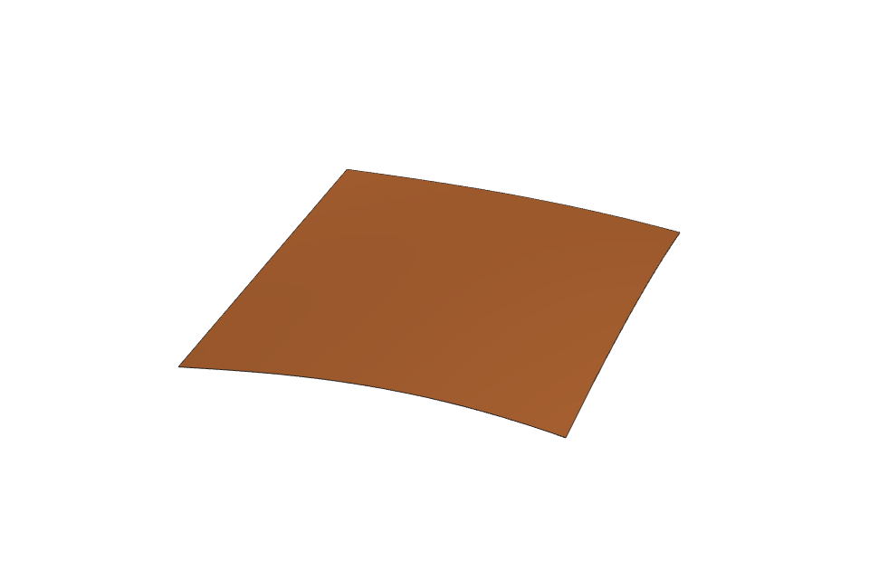

<!-- Copyright (c) 2026 Timon Gentzsch. LGPL-2.1-only WITH OCCT-exception-1.0. -->

# OCCT extensions

Mathematical extensions and corrections for [Open CASCADE Technology](https://dev.opencascade.org) (OCCT) 8.
The repository is OCCT with its history, followed by commits that add

* a toolkit of modelling operations, `TKAlgoExt`: rolling-ball fillets and chamfers, boundary-first Patch fills,
  skinning and sweeps, offsets and shells, curve and surface editing, and cell-based Booleans;
* numerical utilities in `TKGeomAlgo` and `TKMesh`: interval enclosures, Bernstein products, constrained
  tensor-spline fitting, certified knot compaction, trim integration, surface jets;
* twenty corrections to existing OCCT algorithms, one commit each, with the derivation and limits of each.

The base is OCCT `b8f597c6` (30 July 2026). Nothing here has been proposed upstream yet; it is organised so that
it can be proposed in pieces ([Upstreaming](#upstreaming)).

Every added result is checked against a definition or a closed form, not against another implementation:
the rolling-ball definition of a blend, Steiner's volume of a rounded box, Archimedes' volume of two crossed
cylinders, Pappus volumes of sweeps, the curvature and torsion of a circle and a helix. Where stock OCCT is
wrong or invalid on such an input, the number is reported next to it.

## Results


Median CPU time per call, ten runs. Every call of `TKAlgoExt` checks its own result before returning it, so the
fair reference is the middle bar, stock followed by the same check. Hatched bars are calls with no valid or a
wrong result. Selected rows (milliseconds; full table, method and caveats in
[benchmarks.md](dox/extensions/benchmarks.md)):

| Operation | Stock | Stock + check | TKAlgoExt | Quality |
| --- | ---: | ---: | ---: | --- |
| Box, all 12 edges rounded | 2.7 | 3.5 | 1.6 | both exact to 3e-11 (Steiner) |
| Sphere R14 on a box, junction rounded | 1.03 | 1.24 | 0.45 | ball defect: stock 4e-6, TKAlgoExt 1e-14 |
| Round blended into earlier rounds | 5.9 | 7.4 | 7.2 | ball defect: stock 7e-3, TKAlgoExt 2e-9 |
| Crossed cylinders R10 / R6, r = 1 | 10.2 | 12.5 | 8.3 | ball defect: stock 2e-4, TKAlgoExt 2e-8 |
| Fill of four cubic sides | 2.6 | | 1.9 | stock 0.11 off the defining surface, TKAlgoExt 1e-12 |
| Hollow of a filleted box | 2.6 | | 6.8 | stock volume wrong by 3.3e4; TKAlgoExt exact to 1e-11 |
| Smooth skin through six circles | 1.08 | 1.26 | 1.00 | stock bulges to half-width 19.3; sections have radius at most 10 |

It is not uniformly faster: a single circular fillet is level (1.05 times stock plus check), the curve offset is
1.65 times, the smooth skin through square, circle and square 4.3 times, and the hollow 2.6 to 3.2 times
slower while returning a correct body. [benchmarks.md](dox/extensions/benchmarks.md) gives the cause of each.

## Gallery

Results of the operations, rendered from the meshes of example models with three.js.

| | |
| --- | --- |
|  |  |
| Twelve edge blends meeting at eight corners (`BRepBlendExt`, `BRepFilletExt`). | The same body hollowed to a wall of 2 and cut in half (`BRepOffsetExt`). |
|  |  |
| A five-sided fill between free-form faces (`BRepPatchExt`; the neighbouring faces are the grey strips). | A fill at a corner of unequal, set-back rounds; the orange face joins the grey rounds smoothly. |

| | |
| --- | --- |
|  |  |
| Four small rounds on the uprights run into the four large rounds of the top face (rounds blended into existing rounds). | Three rounds of one radius meeting at a single corner. |
|  |  |
| A fill at the corner of three rounds of different radii; the orange face is tangent to all three. | A fill whose boundary lies on a plane, a cylinder and a sphere. |
|  |  |
| A three-sided fill between free-form faces. | A six-sided fill between free-form faces. |
|  |  |
| A four-sided fill between spline faces. | A fill between a round and a flat face. |

| | |
| --- | --- |
|  |  |
| Two crossing cylinders (R10, R6) with their intersection curves rounded by 2.5: the blend follows a space curve where two curved surfaces meet. | A sphere (R14) standing on a box with the circular junction rounded by 6. Stock and this branch agree on the volume to 1e-8 of it. |

| | |
| --- | --- |
|  |  |
| A fill between three tube ends at a Y junction, curvature-continuous with the three grey sheets. | A fill bounded by the edges of six plates round a three-way junction. |
|  |  |
| An open fill between three strips (the boundary is not a closed loop), shaped by guide curves. | A cap between two cylindrical sheets, the whole model turned in space. |
|  |  |
| A hull bottom between sheer lines, turned in space. | A domed top on its boundary curves, turned in space. |
|  | |
| A panel built on an existing neighbouring panel. | |

The last block shows parameterised models of larger shapes with several faces around one fill, open boundaries
and guide curves, each tested at two poses against a closed-form or symmetry oracle. The images illustrate what
is supported; the numbers are in the benchmark and the tests.

## What is added

| Part | Where | What it is |
| --- | --- | --- |
| Corrections | one commit each, [corrections.md](dox/extensions/corrections.md) | Fixes to existing algorithms: quadratic or unbounded loops, wrong ranges, uninitialised reads, missing cancellation. 17 build against current `master` (one needs another of them), three later ones are listed with them. |
| Numerical utilities | `GeomAlgoExt` in `TKGeomAlgo` | Interval enclosures, Bernstein products, spline collocation, constrained tensor-spline fit, rim fit, certified knot compaction, surface jets |
| Patch chart and surveys | `BRepAlgoExt` in `TKMesh` | Cotangent-weight chart of a boundary loop, interior fairness survey, trim integration, read-back |
| Operations | `TKAlgoExt`, nine packages, about 55 000 lines | Listed below |

| Package | Operations | Lines |
| --- | --- | ---: |
| `BRepBlendExt` | Rolling-ball blend solver: ball on two supports, spine marching, section fit, attachment to the body | 15 400 |
| `BRepFilletExt` | Constant, variable, range and station fillets, chamfer, contour and prism support, blend validity checks | 4 800 |
| `BRepPatchExt` | Patch: one face inside a loop of edges (chained, with gaps closed, if the boundary does not close), with G0/G1/G2 to neighbouring faces and interior guides | 6 100 |
| `BRepSurfaceExt` | Surface alignment, bridging, constraint jets, deformation, face support and rebuild, face separation proofs | 7 900 |
| `BRepCurveExt` | Planar and 3D curve offset, outline, tangent circles, corner rounding of wires, G0 to G3 bridge curves, projection, rebuild, refinement, regions, spiral | 6 600 |
| `BRepOffsetExt` | Solid offset, hollow, shell, thicken, push-pull, defeaturing, sewing history | 3 000 |
| `BRepSkinExt` | Gordon and guided skins, framed sweeps, draft | 4 500 |
| `BRepBooleanExt` | Cell-based Booleans with a ladder of fallbacks, checked solids, imprints | 3 900 |
| `BRepToolsExt` | Properties, bounding boxes, dimensions, fairness, hidden-line, failure hints, shared checks and history | 2 700 |

Each operation is described, with its construction, mathematics, sources, unproven choices and stock
counterpart, in [operations.md](dox/extensions/operations.md). The utilities and their error budgets are in
[utilities.md](dox/extensions/utilities.md), the literature in [references.md](dox/extensions/references.md).
"Unproven" always means a number or rule chosen for the code, not derived; the constants are named in the
source next to their use.

## Using the operations

The operations keep shapes under 32-bit handles and report failures by exception. The interface between an
embedding program and the operations is four declarations in `BRepToolsExt_Session.hxx`, which the embedding
program defines:

* `store(OcctKernel&, const TopoDS_Shape&)` registers a shape and returns its handle;
* `get(const OcctKernel&, handle)` returns the shape behind a handle;
* `release(OcctKernel&, handle)` drops a temporary;
* `sessionCancelled()` is polled for cancellation.

`OcctKernel` is declared and never defined here; it is only passed back. A program that keeps shapes in a
`std::vector` needs twenty lines (`adm/scripts/extensions/operation-benchmark.cxx` and the test support
`TKAlgoExt/GTests/BRepExtTest_Support.cxx` are two). Failures are thrown as `BRepExt::Failure`, which derives
from `std::runtime_error` and carries a stable reason code.

### Section policy

What follows from the mathematics is in this tree. What an application chooses is not: the blend section law
for curvature continuity, how a bridge curve chooses tensions it was not given, which control vertices an
alignment keeps, the shape of a sheet extension, and the mapping of a curve deformation. For curvature
continuity, `BRepBlendExt_Policy.hxx` has a conic-section default and refuses curvature-continuous requests
until a caller supplies a law through `BREPBLENDEXT_POLICY_HEADER` and `BREPBLENDEXT_POLICY_CLASS`
([Building](#building)). The derived parts that those choices sit on are here: the G0 to G3 bridge
construction `BRepCurveExt_Bridge.hxx`, which takes the tensions as arguments, and planar corner rounding
`BRepExt::roundWireCorners`.

## Building

The tree is an ordinary OCCT CMake project. `CMakePresets.json` holds two configurations of the modules the
extensions need (no Visualization or Draw, static Release libraries, no FreeType or RapidJSON):

```sh
cmake --preset native && cmake --build --preset native            # build machine
source /path/to/emsdk/emsdk_env.sh                                 # Emscripten 5.0.3
cmake --preset wasm && cmake --build --preset wasm                 # WebAssembly
```

The `wasm` preset sets the toolchain file from `$EMSDK` and compiles with
`-fwasm-exceptions -O3 -msimd128 -DIGNORE_NO_ATOMICS=1 -DOCCT_NO_PLUGINS`. Applications may also
`add_subdirectory()` the tree with the same variables set, and then define the session functions above in
their own objects.

Two options belong to the extension packages (`adm/cmake/occt_extensions.cmake`):

* `BUILD_EXT_KEEP_EXCEPTIONS` (on by default) compiles `TKAlgoExt`, `GeomAlgoExt` and `BRepAlgoExt` with C++
  exceptions and assertions on whatever OCCT's own flags say (`-UNo_Exception -UNDEBUG`), because the operations
  report failures as exceptions and rely on their checks.
* `BREPBLENDEXT_POLICY_HEADER` with `BREPBLENDEXT_POLICY_CLASS` name a header and a class that replace the
  built-in section policy of the blend solver (force-included into the `BRepBlendExt` sources).

## Tests

`-DBUILD_GTEST=ON` adds the target `OpenCascadeGTest`, which runs the tests of every built toolkit; 165 tests
belong to this tree. They live in `TKAlgoExt/GTests/BRep*Ext_Test.cxx` (one file per package) with a shared
session and oracles in `BRepExtTest_Support.*`, in the `GeomAlgoExt` and `BRepAlgoExt` GTests, and in one test
file for each of the corrections to `CSLib_Class2d`, `BRepTopAdaptor_FClass2d` and `BndLib`. For example:

```sh
OpenCascadeGTest --gtest_filter='BRep*Ext*:CSLib_Class2d*:BRepTopAdaptor*:BndLib*'
```

Every expected value comes from a closed form or a definition that does not use the code under test:
Steiner's volume of a box rounded on every edge; the rolling-ball definition of a blend (distance of the ball
centre to the input minus the radius); Archimedes' volume of two crossed cylinders; the frustum and Pappus
volumes of skins and sweeps; the circular segment of three arcs closed by a chord; the position of the circle
touching a line and an arc; and, for bridge curves, the curvature, change of curvature and torsion of a circle
and a helix at the ends. Each test names the defect it would catch.

Operations without a test of their own yet: curve outline and regions, surface bridging, alignment, squaring and
face separation, Gordon and guided skins, thickening, Boolean imprints, and the six-plate fills of the gallery.

## Repository layout

| Path | Content |
| --- | --- |
| `src/ModelingAlgorithms/TKAlgoExt/` | The nine operation packages and their GTests |
| `src/ModelingAlgorithms/TKGeomAlgo/GeomAlgoExt/` | Numerical utilities |
| `src/ModelingAlgorithms/TKMesh/BRepAlgoExt/` | Charts, trim integration, properties |
| `adm/cmake/occt_extensions.cmake` | Build options of the extension packages |
| `adm/scripts/extensions/` | Benchmarks, their results, the chart script, parity harness |
| `dox/extensions/` | Documentation of the additions and the images of this file |

## Upstreaming

OCCT would reasonably take this in pieces: (1) the corrections that apply to `master` today, each alone;
(2) the interval and Bernstein utilities; (3) the spline and rim fits with their GTests; (4) `BRepToolsExt` and
`BRepCurveExt`, which are self-contained and have the clearest closed-form checks; (5) `BRepOffsetExt`; (6) the
blend and Patch solvers last. The namespace `BRepExt`, the handle interface and the diagnostic hooks are
artefacts of how the code was first used. Moving the packages to OCCT's class conventions with
`Standard_Failure` is mechanical but changes behaviour (OCCT code catches `Standard_Failure`), so it is left for
review.

## Open work

Known limits and what remains:

1. **Blend solver.** Some configurations where several blends meet are refused although a valid result exists:
   trimming a blend group needs an owner for every retained region and contact before chain ends are cut, and
   the centre path must be parametrised by arc length along the marched curve, not by the edge's parameter.
   Steep dihedral angles (above about 75 degrees) and curvature-continuous sections at five-sided corners are
   also refused.
2. **Section law for curvature continuity.** `BRepBlendExt_Policy` supplies the conic section only. A published
   bound for a curvature-continuous conic or quintic section as a function of the support's curvature is
   missing.
3. **Fill.** The interior acceptance gate and the flat-support curvature limit have no derivation. The fit's
   stopping decisions depend on rounding and therefore weakly on pose (sampled, not bounded). Fills through
   three profiles with curvature continuity can miss the curvature-share limit. Open boundaries are chained by
   `BRepPatchExt_Chain` (nearest-end growth, gaps closed with straight segments); a general theory of which
   chain a user means is not attempted. Not yet supported: curvature-continuous fills between plates meeting at
   three or more edges at once, steep wing tips with two fixed boundaries and a guide, strips with bending
   flows, flow-direction modes on steep supports, caps whose boundary crosses itself, and profile-curve panels.
4. **Offsets and thickening.** Thickening a sheet whose surface self-crosses is unproven for general splines;
   offsetting solids whose blends meet the wall thickness exactly has no exactness proof.
5. **Speed.** Measured against stock followed by the same check: a single circular edge 1.05 times, the curve
   offset 1.65 times, the hollow 2.6 to 3.2 times, the smooth skin through square, circle and square 4.3 times
   (not yet profiled). Everything else in the [table](dox/extensions/benchmarks.md) is level or faster.
6. **Tests.** The list above.
7. **Conventions.** Formatting is OCCT's (`clang-format` 18.1.8 with the repository's file), headers carry the
   repository's licence text, comments use `//!`, and files are named `Package_Class`. Not done: the packages
   use free functions in namespace `BRepExt`, the handle interface and `std::runtime_error` failures where OCCT
   style would be classes with `IsDone` / `Shape`, `Standard_Failure` and `Message_ProgressRange`; public
   declarations have no `Standard_EXPORT`, so a Windows DLL build would not export them (static and Linux
   builds are unaffected); some messages still say "v2" for the blend solver.
8. **Policy.** The choices listed under [Section policy](#section-policy) are not mathematics and are not
   included.

## Licence and contribution

New files are Copyright (c) 2026 Timon Gentzsch under OCCT's terms: GNU LGPL version 2.1 with the OCCT
exception (`LICENSE_LGPL_21.txt`, `OCCT_LGPL_EXCEPTION.txt`). Existing OCCT files keep their notices.

OCCT's own [contribution workflow](dox/contribution/contribution_workflow/contribution_workflow.md) asks
contributors to sign its Contributor License Agreement before a change is accepted upstream, and to title a
change `<Group> - <Summary>`. The commits here follow that title form. No CLA has been signed; it would be
needed before offering any of this to OCCT.

---

# Open CASCADE Technology

Open CASCADE Technology (OCCT) is a software development platform providing services for 3D surface and solid modeling, CAD data exchange, and visualization. Most of OCCT functionality is available in the form of C++ libraries. OCCT is ideal for developing software dealing with 3D modeling (CAD), manufacturing/measuring (CAM), or numerical simulation (CAE).

## License

Open CASCADE Technology is free software; you can redistribute it and/or modify it under the terms of the GNU Lesser General Public License version 2.1 as published by the Free Software Foundation, with a special exception defined in the file `OCCT_LGPL_EXCEPTION.txt`. Consult the file `LICENSE_LGPL_21.txt` included in the OCCT distribution for the complete text of the license.

Alternatively, Open CASCADE Technology may be used under the terms of the Open CASCADE commercial license or a contractual agreement.

**Note:** Open CASCADE Technology is provided on an "AS IS" basis, WITHOUT WARRANTY OF ANY KIND. The entire risk related to any use of the OCCT code and materials is on you. See the license text for a formal disclaimer.

## Packaging

You can receive certified versions of OCCT code in different packages:

- **Snapshot of Git repository:** Contains C++ header and source files of OCCT, documentation sources, build scripts, and CMake project files.
- **Complete source archive:** Contains all sources of OCCT, generated HTML and PDF documentation, and ready-to-use projects for building on all officially supported platforms.
- **Binary package (platform-specific):** In addition to the complete source archive, it includes binaries of OCCT and third-party libraries built on one platform. This package allows using OCCT immediately after installation.

Certified versions of OCCT can be downloaded from:
- [Open CASCADE Releases](https://dev.opencascade.org/release)
- [GitHub Releases](https://github.com/Open-Cascade-SAS/OCCT/releases)

You can also find OCCT pre-installed on your system or install it from packages provided by a third party. Note that packaging and functionality of such versions can be different from certified releases. Please consult the documentation accompanying your version for details.

## Documentation

Documentation is available at the following links:
- [Latest version](https://dev.opencascade.org/doc/overview)
- [Version 8.0](https://dev.opencascade.org/doc/occt-8.0.0/overview)

Documentation can be part of the package. To preview documentation as part of the package, open the file `doc/html/index.html` to browse HTML documentation.

If HTML documentation is not available in your package, you can:

- **Generate it from sources:** You need to have Tcl and Doxygen 1.8.4 (or above) installed on your system and accessible in your environment (check the environment variable PATH). Use the batch file `adm/gendoc.bat` on Windows or the Bash script `adm/gendoc` on Linux or OS X to (re)generate documentation.
- **Generate together with sources:** You need to have CMake and Doxygen 1.8.4 (or above) installed on your system. Enable `BUILD_DOC_Overview` CMake parameter and set the path to Doxygen `3RDPARTY_DOXYGEN_EXECUTABLE`. Then build ALL or only `Overview`.
- **Read documentation in source plain text (Markdown) format** found in the subfolder `dox` or [GitHub Wiki](https://github.com/Open-Cascade-SAS/OCCT/wiki).

See [dox/build/build_documentation/building_documentation.md](dox/build/build_documentation/building_documentation.md) or [Building Documentation](https://dev.opencascade.org/doc/occt-8.0.0/overview/html/build_upgrade__building_documentation.html) for details.

## Building

In most cases, you need to rebuild OCCT on your platform (OS, compiler) before using it in your project to ensure binary compatibility.

Consult the file [dox/build/build_occt/building_occt.md](dox/build/build_occt/building_occt.md) or [Building OCCT](https://dev.opencascade.org/doc/overview/html/build_upgrade__building_occt.html) or [Building OCCT Wiki](https://github.com/Open-Cascade-SAS/OCCT/wiki/build_upgrade) for instructions on building OCCT from sources on supported platforms.

## Version

The current version of OCCT can be found in the file [`adm/cmake/version.cmake`](adm/cmake/version.cmake).

## Development

### Bug Tracker
- [GitHub Issues](https://github.com/Open-Cascade-SAS/OCCT/issues)
- [OCCT Tracker](https://tracker.dev.opencascade.org/)

For information regarding OCCT code development, please consult the official OCCT Collaborative Development Portal:
- [OCCT Development Portal](https://dev.opencascade.org)

### Forum and Discussions
- [OCCT Forums](https://dev.opencascade.org/forums)
- [GitHub Discussions](https://github.com/Open-Cascade-SAS/OCCT/discussions)

