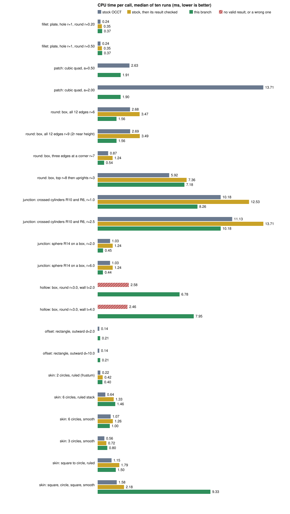

# Benchmarks and reproduction

## Whole operations against stock OCCT

Median process CPU time of ten runs after one warm-up (`std::clock`), one thread, GCC 12.2 `-O3`, static
Release libraries, TBB off, AMD Ryzen 9 7950X3D on a shared machine. The complete output with minima and maxima is
[operation-benchmark-results.txt](../../adm/scripts/extensions/operation-benchmark-results.txt); rerun it with
`adm/scripts/extensions/operation-benchmark.sh NATIVE_BUILD_DIRECTORY` and redraw the chart with
`operation-chart.py`. Checking a result (validity, volume, length, ball defect) is excluded from the clock,
**except** in the bars called "stock, then its result checked". Those add the check that every call of TKAlgoExt
makes on its own result before returning it: `BRepExt::invalidity(result, input)`, which looks at the faces the input
does not hold and then at each solid and shell as a whole (a `BRepCheck_Analyzer` pass over the whole body would
make the single fillet 0.60 ms instead of 0.35). Stock does not check, so that bar is the like-for-like
comparison for an operation that must return only valid bodies. Volumes are computed by adaptive Gauss-Kronrod
integration to 1e-8 (the default fixed rule is off by about 1e-5 on spline blends, which looks like a
difference between implementations and is not). Hatched bars are calls with no valid result or a wrong one.

| Operation | Input | Stock ms | Stock + check ms | TKAlgoExt ms | Result |
| --- | --- | ---: | ---: | ---: | --- |
| Round | plate, hole r=1, edge r=0.2 / 0.5 | 0.24 / 0.24 | 0.35 / 0.35 | 0.37 / 0.37 | both exact to 5e-12 (closed form) |
| Round | box, all 12 edges, r=6 / r=9 | 2.7 / 2.7 | 3.5 / 3.5 | 1.6 / 1.6 | both exact to 3e-11 (Steiner) |
| Round | box, three edges at a corner, r=7 | 0.87 | 1.24 | 0.54 | same volume |
| Round | box, top r=8 then uprights r=3 | 5.9 | 7.4 | 7.2 | ball defect: stock 7e-3 at most, TKAlgoExt 2e-9 |
| Round | crossed cylinders R10/R6, r=1 / 2.5 | 10.2 / 11.1 | 12.5 / 13.7 | 8.3 / 10.2 | ball defect: stock 2e-4 / 3e-3, TKAlgoExt 2e-8 / 3e-8 |
| Round | sphere R14 on a box, r=2 / 6 | 1.03 / 1.03 | 1.24 / 1.24 | 0.45 / 0.44 | volumes agree to 1e-7; ball defect: stock 4e-6, TKAlgoExt 1e-14 |
| Fill | four cubic sides, a=0.5 / 2.0 | 2.6 / 13.7 | | 1.9 / 1.9 | stock 0.11 / 0.45 off the defining surface, TKAlgoExt 1e-12 |
| Hollow | filleted box, wall 2 / 4 | 2.6 / 2.5 | | 6.8 / 8.0 | stock volume wrong by 3.3e4 / invalid; TKAlgoExt exact to 1e-11 |
| Curve offset | rectangle, d=2 / 10 | 0.14 / 0.14 | | 0.23 / 0.23 | both exact |
| Skin | two circles, ruled | 0.22 | 0.42 | 0.40 | frustum volume, both exact to 2e-11 |
| Skin | six circles at unequal heights, ruled | 0.64 | 1.33 | 1.46 | stack of frusta, both exact to 1.3e-11 |
| Skin | six circles, smooth | 1.08 | 1.26 | 1.00 | stock bulges to half-width 19.3 through sections of radius at most 10 (volume 13 000, more than any profile within the sections allows); TKAlgoExt 10.0 |
| Skin | three circles, smooth | 0.56 | 0.72 | 0.80 | both valid; sections lie on the result to 1.5e-8 (stock) and 7e-15 (TKAlgoExt) |
| Skin | square to circle, ruled | 1.15 | 1.79 | 1.50 | same volume |
| Skin | square, circle, square, smooth | 1.58 | 2.18 | 9.3 | both valid (TKAlgoExt's was an unconnected solid before [this correction](corrections.md#brepskinext-section-vertices-exact)) |

*Ball defect.* The exact blend of radius r on a body B is the envelope of the balls of radius r that lie on one side
of the surface and touch B; so for a point P of it with unit normal N, the centre c = P -/+ rN is at distance exactly r
from the faces of B (c = P - rN where the ball is in the material, P + rN where it is in the void). The defect
dist(c, faces of B) - r is therefore zero for the exact blend, positive where the surface lies inside the exact one
(more material removed) and negative where it lies outside. It uses neither implementation (24 x 24 interior samples per
new face, the side of each face taken as the one with the smaller mean square; centres where the blend runs out onto a
face and the ball cannot roll are left out, as the bottom face in the reblend row). It measures a result against the
definition of the operation, and a result of 1e-8 means the sampled points are exact to that, not that every point is.
Where the two implementations' volumes differ, this accounts for it: the rms defect of stock's reblend, 1.25e-3, times the
area of its new faces, 387, is 0.49 (an rms bounds the mean from above), against 0.48 for the difference of the
volumes; stock's blends are the approximations and TKAlgoExt's are exact to the sampling.

How to read it, without flattering it:

* **Where TKAlgoExt is faster than the checked stock bar:** twelve-edge and corner rounds (2.2 and 2.3 times), the sphere on a
  box (2.8 times), the crossed cylinders (1.5 and 1.3 times), the fill (which is also exact where stock is not), the smooth skin
  through six circles (which also stays within the radius of its sections where stock bulges to nearly twice it) and the ruled
  skin from a square to a circle (1.2 times).
* **Where it is level:** a single circular edge is 1.05 times the checked stock bar (0.37 against 0.35 ms; the remaining 0.02 ms is
  face history and the closedness test), the round blended into earlier rounds is 0.97 times, the ruled skins are 1.0 to 1.1
  times (they call the same `BRepOffsetAPI_ThruSections`; the extra is lining up the rings).
* **Where it is slower:** the curve offset (1.65 times; it brings the curve to a working size so that offsets behave at any scale,
  redraws it, builds the plane and polylines and tests the result for self-crossing, none of which stock does, and the offset
  itself costs the same), the hollow (2.6 to 3.2 times, against a stock call that returns a wrong or invalid body; 22 per cent of it
  is the check that the wall is nowhere thinner than asked, 12 per cent validity checks, the rest OCCT's offset, defeaturing and
  Boolean), the smooth skin through three circles (1.1 times) and the smooth skin through a square, a circle and a square (4.3
  times: TKAlgoExt's own Gordon-type construction against stock's; not yet profiled).
* **What changed:** a profile of the sphere on a block found 80 per cent of the call in an exact face-to-face distance between the
  toroidal blend and the block's far sides. `BRepBndLib` boxes a face that is not planar by its whole surface, so the box of the
  blend was that of the entire torus and reached the sides, and the torus box that `BndLib` gives for a parameter range was itself
  smaller than the patch (see [BndLib-torus-patch-box](corrections.md#bndlib-torus-patch-box)). With both fixed the test is skipped where the box
  says it must be. A profile of the reblend and the crossed cylinders then found a quarter of the call in point-in-face
  classification, which scanned every vertex of the face's boundary polygon up to five times per point
  ([CSLib_Class2d-v-bucket-index](corrections.md#cslib_class2d-v-bucket-index)), and 6 per cent in rebuilding a surface adaptor per query
  ([BRepTopAdaptor_FClass2d-periods-read-once](corrections.md#breptopadaptor_fclass2d-periods-read-once)).
* **Fill and hollow** show the cases stock does not handle well, on inputs with closed forms; they say nothing about
  general loops.

A rigorous claim about speed or quality on general inputs needs a corpus rather than a dozen rows; the corpus used
during development cannot be redistributed with this tree.

## Corrections: aggregate fixtures

Use Linux, CMake, Ninja, a C++17 compiler and static Release libraries.
`adm/scripts/extensions/compare.sh BASE CANDIDATE OUTPUT_DIRECTORY` creates two
worktrees, builds both and runs the same benchmark source against each. For the tables
below BASE is `b8f597c6` and CANDIDATE is `14f92b09`, the last of the first seventeen
[corrections](corrections.md). To measure one correction alone, create a branch at BASE,
cherry-pick that correction (and its listed dependency) and pass the branch as CANDIDATE.
The WebAssembly exception and null-curve commits are in the aggregate candidate; the
native benchmarks do not exercise those paths.

The benchmark uses `std::clock()` process CPU time, one warm-up and ten measured
runs per case; setup is outside the clock except sphere construction in the mesh
case. Measurements: AMD Ryzen 9 7950X3D, GCC 12.2, `-O3`, TBB off, six CPUs. These are observed medians, not complexity bounds or universal speedups.
The four finite fixtures do not exercise every correction. A build and unchanged
fixture result are not a triggering regression test for an unexercised correction.

Fixtures have independent checks: a 100×80×2 plate with 32 radius-one through holes
has volume `16000−64π` and area `16720+64π`; 20,000 face classification queries
are checked against the disk complement (19,760 inside). Filleting the top hole
edges by radius r=0.2 removes another `32π[2r²+(5/3)r³−(π/2)(1+r)r²]`.
This follows integrating `π[((1+r)−sqrt(r²−t²))²−1]` from t=0 to r
for each of the 32 quarter-circle profiles. The volume check runs outside
the measured interval. Classification checks the aggregate inside count. A radius-ten sphere meshed at
linear deflection 0.01 and angular deflection 0.1 checks mesh vertices against the
sphere. Its 10,176 triangles and filleted volume 15797.13503629154 were identical
between these two builds. These checks do not certify every topological invariant.

| Aggregate CPU median, ms | Stock same base | Corrections | Ratio |
| --- | ---: | ---: | ---: |
| Plate properties | 4.645 | 4.349 | 0.936 |
| Plate classification | 144.9025 | 4.829 | 0.0333 |
| Plate fillet | 11.2375 | 11.1585 | 0.993 |
| Sphere mesh | 34.020 | 26.987 | 0.793 |

Sample minima/maxima and per-correction values are in
[measurements.json](../../adm/scripts/extensions/measurements.json).
Every standalone same-base correction built and completed all four fixtures.
The analytic fillet-volume check runs outside the clock. Noise and regressions in
individual observations remain visible in that file; each entry records the ten-sample
median and extrema, not every timing.

| One correction on stock base, CPU median ms | Properties | Classification | Fillet | Mesh |
| --- | ---: | ---: | ---: | ---: |
| Approx_BSplComputeLine-local-endpoint-parameters | 4.528 | 144.438 | 11.102 | 33.727 |
| BOPAlgo_RemoveFeatures-extend-across-feature | 4.468 | 143.753 | 11.858 | 33.534 |
| BRepAlgo_Loop-sort-vertices | 4.522 | 149.160 | 11.270 | 33.138 |
| BRepCheck_Solid-stop-after-enclosed-region | 4.422 | 141.957 | 11.589 | 33.758 |
| BRepFill_Draft-orientation-last-sample | 4.736 | 143.969 | 11.293 | 32.091 |
| BRepGProp_Gauss-used-errors | 4.368 | 147.476 | 11.118 | 32.648 |
| BRepMesh_Delaun-hilbert-insertion | 4.229 | 140.642 | 11.428 | 26.280 |
| BRepMesh_DelaunayDeflectionControlMeshAlgo-node-normals | 4.488 | 140.654 | 11.019 | 33.898 |
| Geom_OffsetSurfaceUtils-cancellable-progress | 4.447 | 144.507 | 11.335 | 33.918 |
| BRepOffset_MakeOffset-cancellable-tolerances | 4.328 | 146.446 | 10.976 | 33.206 |
| BRepOffset_MakeOffset-input-order | 4.363 | 142.315 | 11.386 | 32.689 |
| BRepTopAdaptor_FClass2d-wire-bounds | 4.533 | 5.003 | 11.198 | 32.855 |
| Extrema_ExtPExtS-spline-across | 4.656 | 145.131 | 11.127 | 32.544 |
| IntTools_BeanFaceIntersector-whole-range | 4.953 | 143.904 | 11.118 | 33.328 |
| IntTools_EdgeFace-line-plane-touch | 4.219 | 146.035 | 11.046 | 32.903 |
| IntTools_FaceFace-plane-across-sweep | 4.532 | 151.938 | 10.979 | 32.733 |
| TopOpeBRepBuild_WireEdgeClassifier-box-apart | 4.662 | 144.457 | 10.789 | 35.466 |

